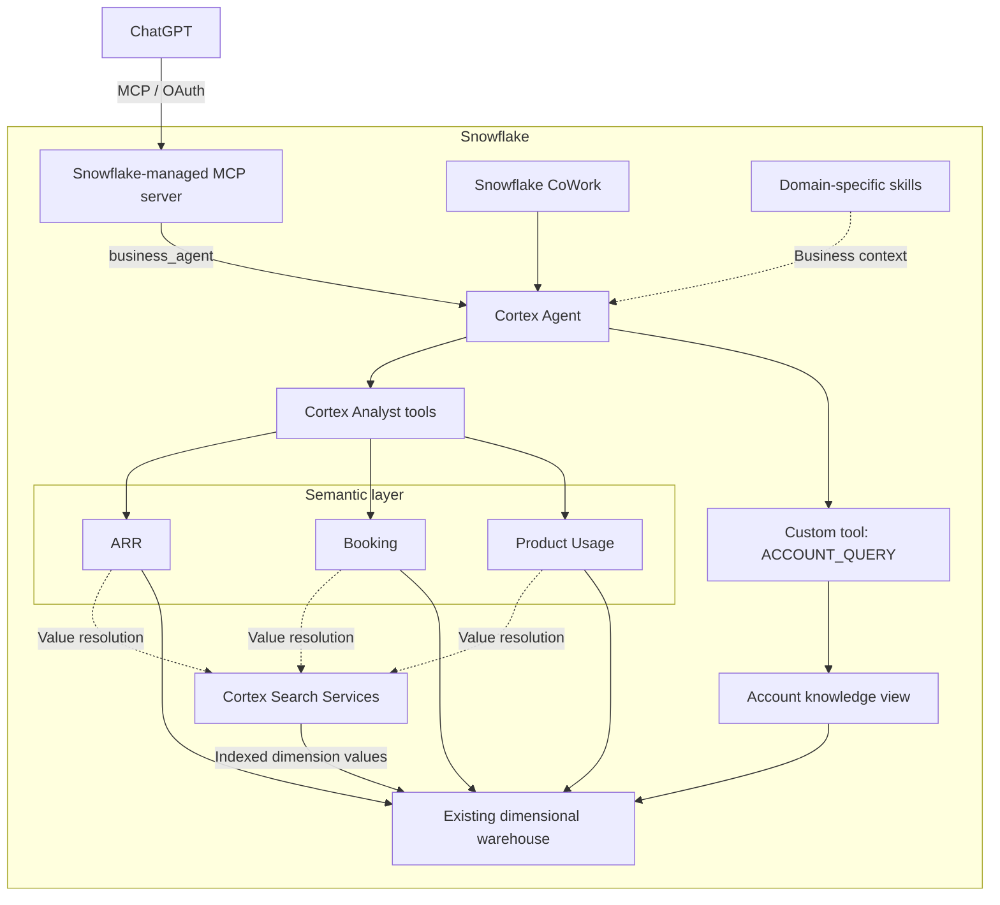
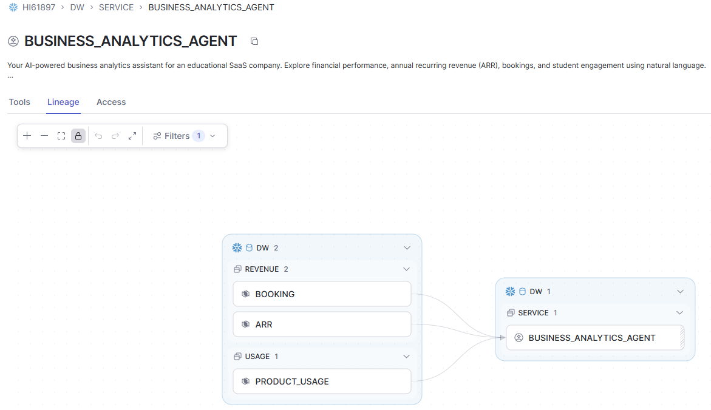
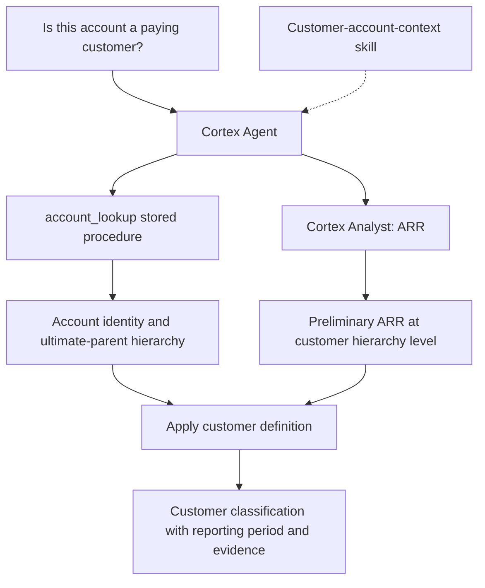
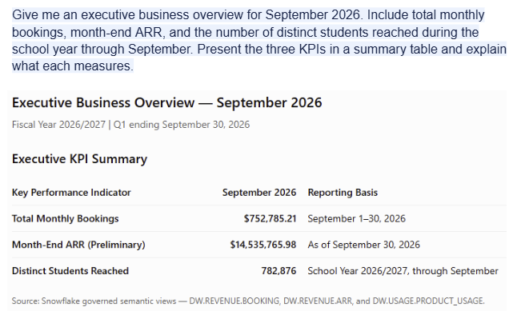
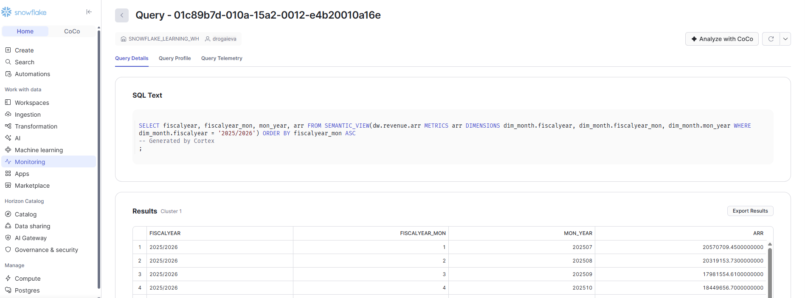

# Snowflake-Native Analytics Agent with Semantic Views and MCP

[Project Overview](README.md) · [Data Model](data/README.md) · [Semantic Views](semantic_views/README.md) · [Cortex Agent](agent/README.md) · [Evaluation](evaluation/README.md) · [MCP Integration](mcp/README.md) · [Demo](demo/README.md) · [Production Roadmap](production/README.md)

---

**Combining governed business metrics, domain knowledge, and AI reasoning in a Snowflake-native analytics architecture.**

## Overview

This project demonstrates an end-to-end business analytics agent for an educational SaaS company, built on Snowflake Semantic Views, Cortex Analyst, Cortex Agent, domain-specific skills, custom tools, and a Snowflake-managed Model Context Protocol (MCP) server.

The objective is not simply to translate natural-language questions into SQL. It is to enable an AI agent to retrieve governed metrics, understand their business meaning, interpret organizational relationships, and combine evidence across business domains.

The implementation was tested through Snowflake CoWork and ChatGPT connected via the Snowflake-managed MCP server.

## Project scope

The project assumes an existing, populated dimensional data warehouse. Data ingestion, transformation pipelines, source datasets, and warehouse population are outside its scope. Selected table and view definitions are included to explain the underlying data model and its relationship to the semantic layer.

This repository is an architectural reference and a demonstrated implementation, not a standalone deployment package. Source data is not distributed.

## Architecture



The architecture separates four responsibilities:

- **Data foundation:** dimensional tables and reporting views supply the underlying business data.
- **Semantic layer:** centrally defines metrics, relationships, dimensions, and aggregation behavior.
- **Business knowledge and orchestration:** Cortex Agent combines domain-specific instructions with analytical and contextual tools.
- **External access:** a managed MCP server exposes the Cortex Agent to an external AI client through authenticated access.




## Governed semantic layer

Three semantic views cover financial performance and product engagement. They deliberately represent different types of metric aggregation.

| Semantic view | Business domain | Aggregation behavior |
| --- | --- | --- |
| `DW.REVENUE.BOOKING` | Bookings and sales activity | Fully additive across reporting periods and supported dimensions |
| `DW.REVENUE.ARR` | Annual recurring revenue | Semi-additive: balances may be aggregated across appropriate entities, but not summed across monthly snapshots |
| `DW.USAGE.PRODUCT_USAGE` | Student engagement and product adoption | Non-additive pre-calculated distinct-student counts at predefined organizational levels; cumulative launch events are also non-additive across time |

### Bookings

Bookings represent financial activity during a period. Monthly bookings can be summed to calculate fiscal-quarter or fiscal-year bookings. The fiscal calendar runs from July through June.

### Annual recurring revenue (ARR)

ARR represents a recurring revenue balance at a point in time, rather than financial activity accumulated over a period. Three alternative perspectives are modeled: Preliminary ARR (the default), True ARR, and Backdated ARR. These measures must not be added together. The semantic view uses non-additive time behavior to select the latest available snapshot within the reporting period.

### Product usage

Student reach is calculated as cumulative school-year-to-date distinct counts at school, district, state, country, and company levels. A higher-level distinct count cannot safely be calculated by summing overlapping lower-level counts. The model uses separately pre-aggregated measures and snapshot and rollup selection rules for grade and product. Student launch events are distinct from unique students.

The semantic definitions also include business descriptions, synonyms, AI guidance, and verified query examples.

See [Semantic Views](semantic_views/README.md) for metric definitions and modeling decisions and [Data Model](data/README.md) for the underlying data structures.

## Business knowledge beyond metric definitions

A correct metric does not necessarily answer a business question. For example, an organization can have product licenses and active students without being a paying customer.

The agent uses three domain-specific skills:

| Skill | Responsibility |
| --- | --- |
| `customer-account-context` | Commercial and operational hierarchies, customer identity, state initiatives, and product access |
| `financial-metric-interpretation` | ARR types, booking interpretation, metric selection, and reporting periods |
| `student-usage-interpretation` | Distinct students, launch events, cumulative snapshots, and organizational aggregation |

These Markdown skills provide lightweight business knowledge and ontology-like guidance. They are not presented as a formal ontology or knowledge graph.

### Example: What makes an account a paying customer?

The account lookup tool retrieves account attributes, including hierarchy and state-initiative information. It does not calculate ARR or independently classify customers. The agent separately retrieves governed Preliminary ARR through Cortex Analyst and applies the business definition.



A paying customer must be the ultimate-parent account and have positive Preliminary ARR at the customer-hierarchy level in the current reporting month. If that month's data is unavailable, the agent should describe the latest available evidence rather than claim verified current status. A state-initiative flag can explain access without direct payment, but does not by itself identify the payer.

See [Cortex Agent](agent/README.md) for orchestration instructions, custom tool design, and skills.

## Cortex Agent and external AI integration

The `DW.SERVICE.BUSINESS_ANALYTICS_AGENT` object orchestrates three Cortex Analyst tools (ARR, Bookings, and Usage) and the custom `account_lookup` tool implemented by `DW.SERVICE.ACCOUNT_QUERY`.

The agent is configured to select appropriate tools, preserve reporting context across follow-up questions, retrieve data before answering analytical questions, and distinguish observed results from interpretations.

The `DW.SERVICE.BUSINESS_MCP` managed MCP server exposes the agent through a `CORTEX_AGENT_RUN` tool named `business_agent`. A dedicated user, restricted access role, and OAuth security integration support external access from ChatGPT. No custom MCP application server is required for this implementation.

### One question, multiple semantic views

> Give me an executive business overview for September 2026. Include total monthly bookings, month-end ARR, and the number of distinct students reached during the school year through September.

The observed ChatGPT response combines three KPIs with different reporting bases: monthly financial activity, a month-end financial balance, and cumulative school-year student reach. The metrics are retrieved from their respective semantic views rather than forced into a single common fact grain.


 

See [MCP Integration](mcp/README.md) and the [Snowflake MCP ChatGPT connection guide](mcp/snowflake-mcp-chatgpt.md).

## Validation, evaluation, and observability

The project distinguishes metric correctness from SQL generation correctness and agent answer quality.

| Validation layer | Focus |
| --- | --- |
| Semantic view reconciliation | Compare governed results with reference SQL against the underlying data model |
| Cortex Analyst validation | Inspect generated SQL, metric selection, reporting periods, and verified query behavior |
| Cortex Agent evaluation | Assess answers, logical consistency, tool selection, and tool execution using a 15-question evaluation dataset |
| End-to-end MCP testing | Inspect externally initiated queries, tool calls, and business responses |

### Observed semantic query execution

Snowflake query history from the ChatGPT MCP test session shows explicit `SEMANTIC_VIEW(...)` queries, including ordinary SQL composed around semantic queries for analytical calculations. For example, Cortex generated a semantic query inside a CTE and added month-over-month comparisons and a fiscal-year total in the same SQL statement.

```sql
WITH monthly AS (
    SELECT fiscalyear, fiscalyear_mon, mon_year, booking
    FROM SEMANTIC_VIEW(
        dw.revenue.booking
        METRICS vw_fact_booking.booking
        DIMENSIONS dim_month.fiscalyear,
                   dim_month.fiscalyear_mon,
                   dim_month.mon_year
    )
    WHERE fiscalyear = '2025/2026'
)
SELECT c.mon_year,
       c.booking,
       p.booking AS previous_booking,
       c.booking - p.booking AS mom_change,
       (c.booking - p.booking) / NULLIF(p.booking, 0) AS mom_pct,
       SUM(c.booking) OVER () AS fy_total
FROM monthly c
LEFT JOIN monthly p
    ON c.fiscalyear_mon = p.fiscalyear_mon + 1
ORDER BY c.fiscalyear_mon;
```

*Adapted for readability from an observed Cortex-generated query.*


 


## Design considerations and limitations

- Semantic definitions govern metric calculations; skills and agent instructions guide business interpretation but do not guarantee correct reasoning.
- Cross-domain questions require attention to different grains and reporting calendars.
- Customer classification requires both contextual attributes and governed financial metrics; identifying an exact commercial payer may require additional contract evidence.
- Evaluation results should be interpreted in the context of the tested agent version, scoring criteria, and data quality. Successful SQL execution alone does not establish answer correctness.
- The implementation documents a specific tested configuration, not a universal security or deployment pattern.

## From Prototype to Production

The current implementation demonstrates the core capabilities of a governed, Snowflake-native AI analytics agent.

Moving this solution into production requires a sustainable approach to monitoring, evaluation, maintenance, security, and controlled deployment. The level of operational complexity should be proportional to the business value, usage, and risk of the solution.

The objective is to establish a continuous improvement lifecycle in which real business questions inform semantic model enhancements, approved evaluation cases, and measurable release quality.

Two production approaches are proposed:

- **[Minimum Viable Production](production/minimum-viable-production.md)** — a practical approach for small data teams or a single Analytics Engineer, using native Snowflake monitoring, incremental evaluation datasets, SQL-based regression testing, and controlled manual deployment.

- **[Comprehensive Production Roadmap](production/README.md)** — an extended architecture for organizations requiring advanced observability, automated regression testing, CI/CD quality gates, environment isolation, controlled version promotion, and rollback procedures.

Both approaches follow the same principles of data governance, evaluation-driven improvement, and controlled change management, while differing in the level of automation and operational complexity.

The production approaches are proposed implementation plans, supported by illustrative SQL, YAML, Python, and GitHub Actions examples, rather than implemented components of the current project.

## Repository structure

```text
.
+-- README.md
+-- data/               # Existing warehouse definitions and context
+-- semantic_views/     # ARR, Booking, Product Usage semantic definitions
+-- agent/              # Cortex Agent, custom tools, and domain skills
+-- mcp/                # Managed MCP server, access, OAuth, and connection guide
+-- skills/             # Cortex Agent SKILLS md files
+-- evaluation/         # Evaluation questions, reference SQL, and results
+-- assets/             # Architecture and selected technical screenshots
+-- demo/               # Business walkthrough
+-- production/         # Production Roadmap
```

## Related project

[**business-context-ai**](https://github.com/KaterynaD/business-context-ai) explores the same architectural concept using dbt Core Semantic Layer (MetricFlow), a custom MCP server, and lightweight business ontology.

| Component | dbt-based implementation | Snowflake-native implementation |
| --- | --- | --- |
| Semantic layer | MetricFlow | Snowflake Semantic Views |
| Business knowledge | Ontology guidance and skills | Cortex Agent skills |
| Analytical query generation | MetricFlow | Cortex Analyst |
| Agent orchestration | External AI agent | Cortex Agent |
| Custom contextual tools | Python functions | Snowflake stored procedure |
| MCP | Custom MCP server | Snowflake-managed MCP server |
| Demonstrated external client | Codex | ChatGPT |

Both implementations explore how governed metrics and explicit business knowledge can support AI reasoning beyond SQL generation.
