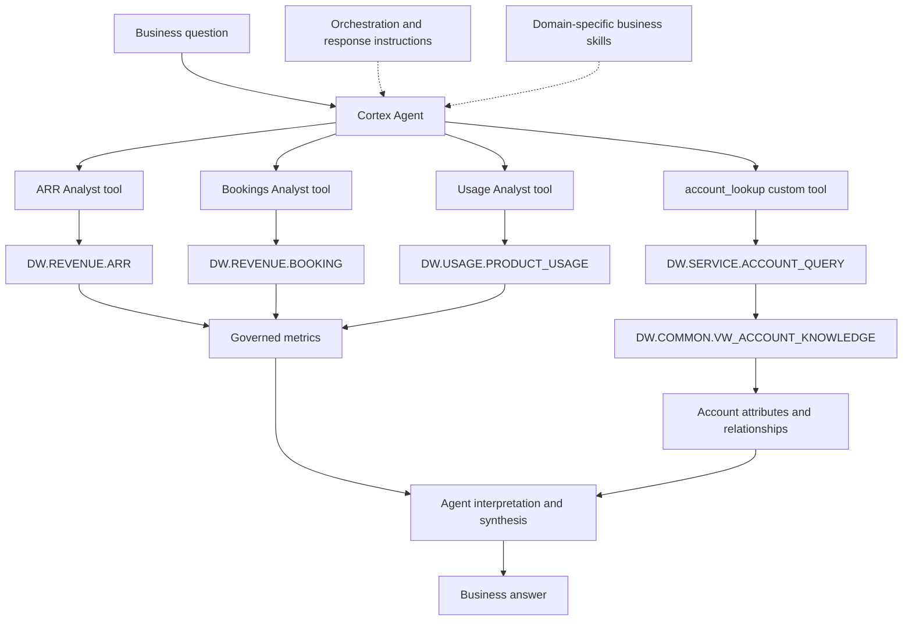
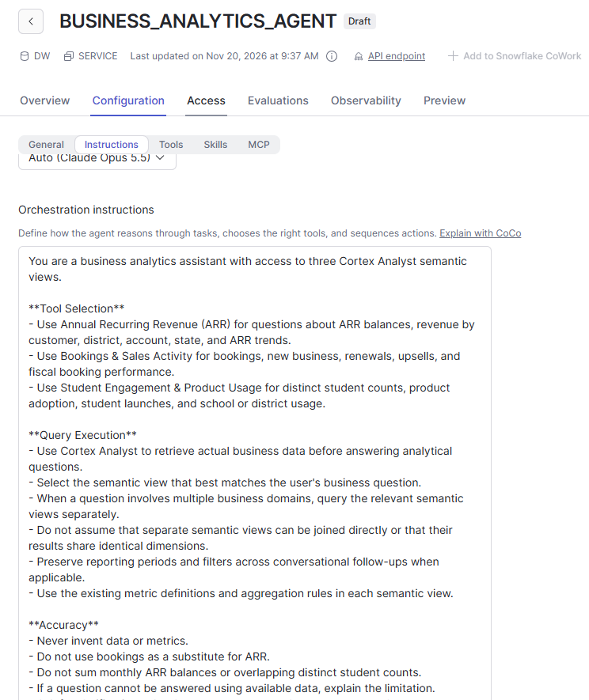
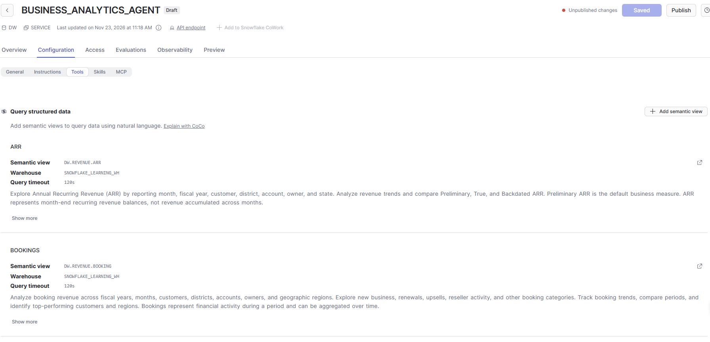
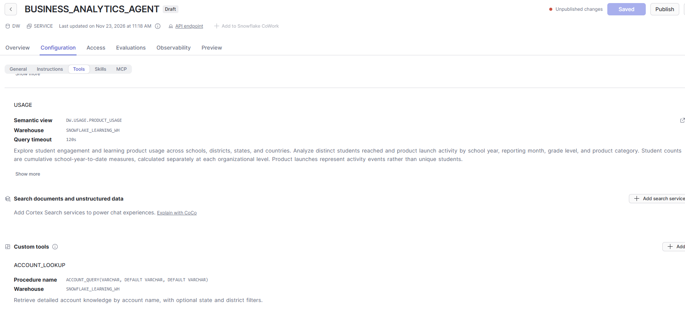
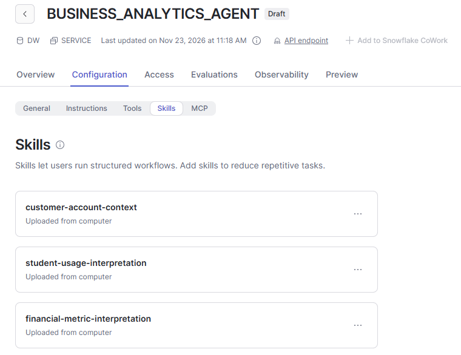
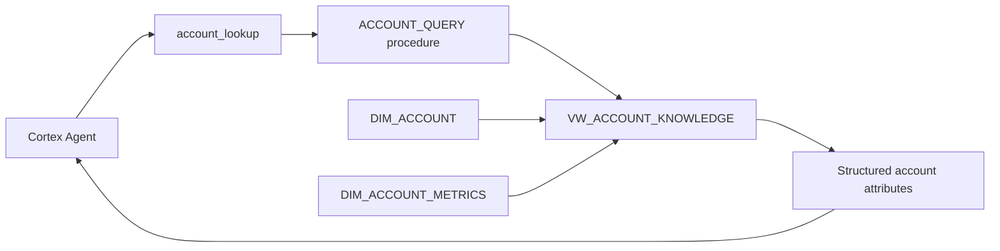
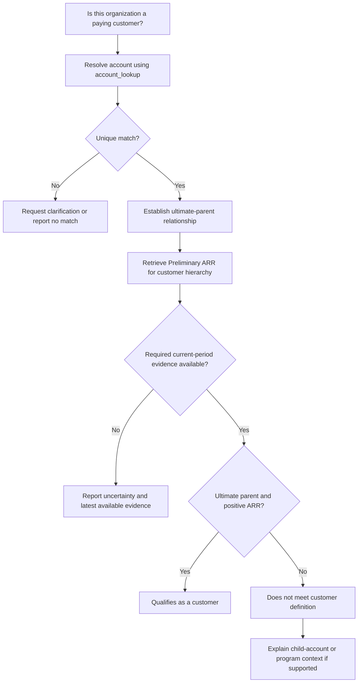
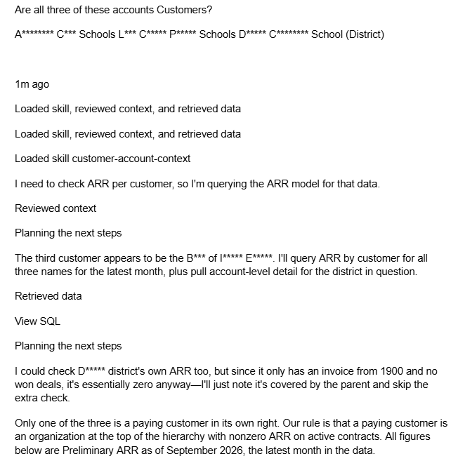
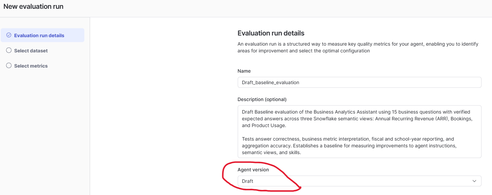

# Cortex Agent Orchestration, Business Knowledge and Custom Tools

[? Project overview](../README.md) | [Semantic Views](../semantic_views/README.md)

## Overview

The Business Analytics Assistant is a Snowflake Cortex Agent designed for an educational SaaS company. It combines governed financial and product usage metrics with domain-specific business knowledge and account-level context.

The objective is to go beyond text-to-SQL: the agent must determine which business concept the user is asking about, select the appropriate analytical or contextual tool, interpret the evidence according to business rules, and communicate the result without inventing unsupported conclusions.

The implementation assumes an existing populated dimensional warehouse and three Snowflake Semantic Views. Warehouse population is outside the project scope.

## 1. Agent architecture



The diagram represents logical responsibilities, not a mandatory sequence of calls. The agent may invoke one or several tools, revisit a tool, or answer a conceptual question without retrieving numerical data.

| Component | Responsibility |
| --- | --- |
| Cortex Agent | Interpret intent, select tools, coordinate requests, combine evidence and formulate the answer. |
| Cortex Analyst | Generate analytical SQL using the selected semantic view and its available metrics, dimensions, instructions and verified queries. |
| Semantic Views | Define governed metric calculations, relationships and aggregation semantics. |
| Skills | Supply domain definitions, reporting intent, business rules and interpretation guidance. |
| Custom account lookup | Resolve organizational identity and retrieve contextual attributes that are not analytical metrics. |
| External client | Present the conversation and, when applicable, perform additional orchestration or interpretation. |

The agent is a Snowflake database object, `DW.SERVICE.BUSINESS_ANALYTICS_AGENT`, exposed to external clients through the managed MCP server. See [MCP integration](../mcp/README.md).

## 2. Agent configuration and orchestration

The exported agent specification contains the profile, model settings, orchestration budget, instructions, sample questions, tool definitions, skill references and tool resources.

| Setting | Configured value |
| --- | --- |
| Display name | Business Analytics Assistant |
| Orchestration model | `auto` |
| Orchestration budget | 300 seconds; 5,000 tokens |
| Analyst execution warehouse | `SNOWFLAKE_LEARNING_WH` |
| Analyst query timeout | 120 seconds per configured tool |
| Custom procedure query timeout | 600 seconds |

These are the values in the archived DDL, not measured latency or guarantees that a request will run for these durations.

### Orchestration instructions

Orchestration instructions govern how the agent approaches a question:

- Select the tool appropriate to the business domain.
- Retrieve actual governed data before answering numerical analytical questions.
- Query relevant semantic views separately for questions spanning multiple domains; do not assume compatible grains or direct joinability.
- Preserve the applicable reporting periods and filters across follow-up questions.
- Respect metric definitions and aggregation rules. Never substitute bookings for ARR or sum overlapping distinct-student counts.
- Ask for clarification when ambiguity materially affects correctness.

### Response instructions

Response instructions govern how the evidence is communicated:

- Lead with the answer, identify the reporting period and use appropriate units.
- Present comparisons, trends and charts when appropriate.
- Identify the ARR type and distinguish distinct students from launch events.
- Separate observed data from possible explanations; do not invent causes, business events or metrics.
- Explain unavailable information and limitations in business language.

Some accuracy rules appear in both instruction sets and in the skills. This intentional reinforcement provides guidance at different stages of the workflow; it is not a deterministic enforcement mechanism.

 

## 3. Cortex Analyst tools

The agent exposes three tools of type `cortex_analyst_text_to_sql`. Each is configured against one semantic view.

| Tool | Semantic view | Typical questions |
| --- | --- | --- |
| `ARR` | `DW.REVENUE.ARR` | Month-end ARR, customer-level ARR, fiscal trends, comparison of ARR types |
| `Bookings` | `DW.REVENUE.BOOKING` | New business, renewals, upsells, fiscal booking performance |
| `Usage` | `DW.USAGE.PRODUCT_USAGE` | Unique students, launch events, school-year adoption, geographic and product breakdowns |

For example, a tool resource in the agent specification is configured as follows:

```yaml
tool_resources:
  ARR:
    execution_environment:
      query_timeout: 120
      type: "warehouse"
      warehouse: "SNOWFLAKE_LEARNING_WH"
    semantic_view: "DW.REVENUE.ARR"
```

Tool descriptions help the agent distinguish domains. The metric definitions, aggregation behavior and verified queries remain in the semantic views rather than being implemented again in agent instructions.

### Cross-domain questions

An executive overview for September 2026 can require three separate analytical requests:

| Requested KPI | Tool | Reporting interpretation |
| --- | --- | --- |
| Monthly bookings | `Bookings` | Financial activity during September |
| Month-end ARR | `ARR` | Preliminary ARR at the September month-end snapshot unless another type is requested |
| Distinct students reached | `Usage` | Company-level distinct count from July through September of school year 2026/2027 |

The agent combines the resulting KPIs into an executive response. It does not need to join finance and usage facts, which have different grains, or treat the three metrics as interchangeable.






For detailed metric definitions, custom calendars, pre-aggregated distinct counts, product overlap and semantic SQL examples, see [Semantic Views](../semantic_views/README.md).

## 4. Business knowledge and skills

A semantic view describes how a metric is calculated, but not every business question is a request for a metric. For example, a question about which ARR type to use for forecasting requires knowledge of the reporting objective. A question about whether a district is a customer requires a definition of customer identity and evidence from multiple sources.

This project represents that knowledge using three domain-specific `SKILL.md` files. Each contains descriptive metadata, business definitions, interpretation rules, workflows and examples.

| Skill | Responsibility |
| --- | --- |
| [customer-account-context](skills/customer-account-context/SKILL.md) | Account identity, commercial versus operational hierarchy, paying-customer definition, state initiatives and product access |
| [financial-metric-interpretation](skills/financial-metric-interpretation/SKILL.md) | Choosing the appropriate ARR type based on reporting intent, distinguishing balances from flows and interpreting financial results |
| [student-usage-interpretation](skills/student-usage-interpretation/SKILL.md) | Distinct students versus launch events, school-year snapshots, geographic metric selection and overlapping categories |

These skills express business glossary concepts, relationships and rules as natural-language guidance a lightweight, ontology-like representation of business context. They are not a formal ontology, a knowledge graph or an executable inference engine. The language model interprets and applies the rules to the available evidence.

### Financial metric interpretation: reporting intent matters

The three ARR types are alternative perspectives on the same recurring business, not independent revenue streams.

| Reporting intent | Metric | Interpretation |
| --- | --- | --- |
| Current operational position, expected continuity or near-term outlook | `ARR` (Preliminary) | Includes limited renewal grace periods; business default |
| Operationally confirmed recurring revenue | `TRUE_ARR` | Based on confirmation events; no renewal grace period |
| Retrospective contractual-period alignment after confirmations | `BACKDATED_ARR` | Historical adjustments; rolling 12-month recalculation |

An explicit ARR type takes precedence. A historical date alone does not imply Backdated ARR. A current snapshot is not a numerical forecast, and operational confirmation is not recognized accounting revenue or cash received.

Preliminary ARR can account for renewal delays using the documented grace periods: six months for State/Biz Dev, 90 days for Texas accounts and 60 days for other district accounts. These rules are interpretation context; the skill does not recompute ARR from contracts. The actual numerical measures come from the ARR semantic view.

The skill also explicitly limits what can be answered without detailed contract evidence. Its reference to a fuller ARR knowledge document is conditional on that document being available; this repository does not assume access to it.

### Student usage interpretation: choose the correct measure and grain

The skill directs the agent to use the geographic metric matching the requested distinct-student reporting level: `SCHOOL_STUDENTS`, `DISTRICT_STUDENTS`, `STATE_STUDENTS`, `COUNTRY_STUDENTS` or `COMPANY_STUDENTS`.

It also distinguishes `STUDENTS_LAUNCHES` from unique students. Launch events can be summed across nonoverlapping geographic entities, but not across cumulative school-year snapshots or overlapping product and grade rollups. In particular, one lesson can belong to several products, so product-level launch counts cannot be summed to obtain the overall number of actual launches. The precomputed `(All)` product total is necessary when atomic events are unavailable.

Both fiscal and school years run July–-June in this project. The skill tells the agent which reporting concept to apply and how to label the results. A usage snapshot for September 2026 represents cumulative activity since July 2026, not September-only activity.

### Customer and account context

An account record, a licensed organization, a product user and a paying customer are different concepts. The commercial hierarchy does not necessarily coincide with the operational school/district hierarchy. The skill defines customer status using both identity and financial evidence, as described below.

### Skill registration

The skills were configured in the Snowflake agent interface as inline skills. The exported agent specification contains references such as:

```yaml
skills:
  - name: "customer-account-context"
    source:
      type: "INLINE"
  - name: "student-usage-interpretation"
    source:
      type: "INLINE"
  - name: "financial-metric-interpretation"
    source:
      type: "INLINE"
```

The actual skill text is maintained in the corresponding Markdown files. The archived agent DDL contains references, not the complete inline skill contents. A GitHub file is not automatically accessible to a Snowflake agent; the content must be registered in the agent configuration. This repository documents the implemented architecture rather than promising that the exported DDL alone recreates all inline skills.



## 5. Custom tool: account lookup

The custom `account_lookup` tool is configured as a `generic` tool backed by the Snowflake SQL stored procedure `DW.SERVICE.ACCOUNT_QUERY`.

### Why a separate tool?

Account identity, ultimate-parent mappings, state-initiative participation, licensing and usage indicators are contextual attributes. They can be needed even when the user does not ask for an aggregated metric.

The account lookup retrieves these attributes without calculating ARR, bookings or student counts. This maintains a clear boundary between contextual evidence and governed analytical metrics.



`DW.COMMON.VW_ACCOUNT_KNOWLEDGE` joins `DIM_ACCOUNT` and `DIM_ACCOUNT_METRICS` on `ACCOUNT_ID`. It includes account hierarchy mappings, `STATE_INITIATIVE`, license and usage flags, commercial activity, contract dates, support and training indicators, and the metrics load timestamp.

### Tool parameters

```sql
CREATE OR REPLACE PROCEDURE DW.SERVICE.ACCOUNT_QUERY(
    P_ACCOUNT_NAME VARCHAR,
    P_STATE_CODE VARCHAR DEFAULT NULL,
    P_DISTRICT_NAME VARCHAR DEFAULT NULL
)
RETURNS VARIANT
LANGUAGE SQL
EXECUTE AS OWNER
```

*Procedure signature excerpt; full implementation is in the SQL script.*

| Parameter | Required | Purpose |
| --- | --- | --- |
| `P_ACCOUNT_NAME` | Yes | Partial, case-insensitive organization-name search. Blank or null names return an error. |
| `P_STATE_CODE` | No | Narrow matches to a state code, such as CA or TX. The input is normalized to uppercase. |
| `P_DISTRICT_NAME` | No | Narrow matches by partial, case-insensitive district name. |

Illustrative invocation (example name, not an actual customer):

```sql
CALL DW.SERVICE.ACCOUNT_QUERY(
    P_ACCOUNT_NAME => 'Example Elementary',
    P_STATE_CODE => 'CA'
);
```

### Structured results and ambiguity handling

The procedure returns a `VARIANT` object. The agent can use the status to determine the next step instead of guessing which organization the user meant.

| Status | Returned evidence | Intended agent behavior |
| --- | --- | --- |
| `error` | Error message | Request a valid account name |
| `not_found` | Match count of zero | Explain that no matching account was found |
| `multiple_matches` | Total match count and up to ten candidate summaries | Request disambiguation by name, district or state |
| `ok` | Match count of one and account attributes | Use the resolved account and its mappings for subsequent reasoning |

The multiple-match response includes account ID, name, state code, district name and customer name. The single-match response contains the account knowledge view attributes, retaining nulls.

The procedure uses named SQL bindings and runs with owner rights. The owner and caller grants, exposed attributes and allowed tool surface therefore require deliberate review; the lookup is not intended as a general arbitrary-SQL interface. See [MCP integration](../mcp/README.md) for the external access boundary.

## 6. Business reasoning: is this organization a customer?

The customer definition in this project is intentionally not a stored flag or a metric:

> An account qualifies as a paying customer only when it is the ultimate-parent account of its customer hierarchy and that hierarchy has positive Preliminary ARR in the current reporting month.

The agent must establish both conditions from separate sources of evidence.



This is the intended reasoning workflow from the skill, not hard-coded control flow implemented in the agent.

The lookup supplies the identity and hierarchy (including `CONFORMED_CUSTOMER_ID`, `CONFORMED_CUSTOMER_SFDC_ACCOUNT_ID` and `CUSTOMER_NAME`). The ARR tool supplies the governed financial evidence at the commercial-customer level. A name alone does not establish ultimate-parent status, and opportunity counts, licensing flags or usage do not establish positive ARR.

### Illustrative business scenarios

| Organization | Account knowledge | Governed financial evidence | Interpretation |
| --- | --- | --- | --- |
| A | Ultimate-parent account | Positive current Preliminary ARR for its hierarchy | Qualifies as a paying customer |
| B | Program participant with licenses and usage | No ARR against the individual account | Product access does not itself establish customer status; verify hierarchy and customer-level ARR |
| C | Child district of another customer | Positive ARR at the parent hierarchy | Belongs to a customer; is not itself the ultimate-parent customer |

These are illustrative patterns, not published customer data. If current-month data is unavailable, the agent should report the latest available evidence instead of asserting verified current status.

### State initiatives: who uses versus who pays

`STATE_INITIATIVE` is the authoritative program flag in the account knowledge view. It is stored as `VARCHAR`; the skill interprets the literal `TRUE` case-insensitively as affirmative, `FALSE` as negative, and unknown or missing values as unknown.

For a participating school or district, product access may be covered by another commercial customer. Its own ARR can be zero while its students actively use the products.

The flag does not identify the payer. The agent must not infer that a state government pays solely because the account participates in a state initiative. The relevant commercial relationship must be supported by account or contract evidence. If the user asks for actual student reach, the agent must query the Usage semantic view; `HAS_PRODUCT_USAGE` is only an indicator.

 

### Why not implement customer status in a semantic view?

For a fixed, operationally critical classification, a deterministic SQL rule or governed customer-status model could be preferable. This experiment deliberately leaves the decision to the agent, using explicit business definitions and separately retrieved evidence, in order to explore the reasoning capability of the architecture.

That choice does not imply that language-model reasoning is more reliable than deterministic rules. The separation enables testing whether the agent can distinguish an account from a commercial customer, choose the proper metric and scope, and explain uncertainty.

## 7. Agent lifecycle, validation and observed limitations

The agent can be configured and evaluated in the Snowflake interface. The project captures the configuration as SQL and maintains the skill contents separately. 

 
*Important! Use draft version to evaluate non-published agent changes. Default is Version 1*

The observed tests in Snowflake and through ChatGPT demonstrate semantic-view queries and use of the custom account lookup. Some important limitations remain:


Evaluation examines not just numerical results but also tool selection, ambiguity handling, metric interpretation, customer classification and unsupported claims. See [Evaluation](../evaluation/README.md) and [Query execution analysis](../mcp/query-execution-analysis.md).

## 8. Repository files

```text
agent/
+-- README.md
+-- business_analytics_agent.sql
+-- tools/
¦   +-- account_query.sql
+-- skills/
    +-- customer-account-context/
    ¦   +-- SKILL.md
    +-- financial-metric-interpretation/
    ¦   +-- SKILL.md
    +-- student-usage-interpretation/
        +-- SKILL.md
```

The account knowledge view and supporting tables are documented in [Data Model](../data/README.md). The metric definitions are documented in [Semantic Views](../semantic_views/README.md). This layout assumes the lowercase repository structure described in the root README.

## Conclusion

The semantic layer provides governed calculations. The account lookup provides contextual facts. The skills provide explicit business definitions and interpretation rules. Cortex Agent brings these components together to answer questions that require both analytical retrieval and business reasoning.

The central experiment is whether an AI agent can apply the business meaning of metrics and entities consistently, rather than merely generate syntactically valid SQL.

---

[Back to Project Overview](../README.md)