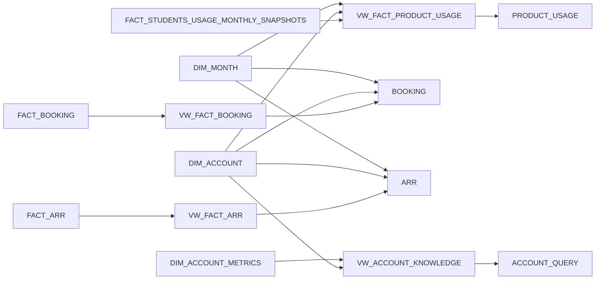

# Supporting Dimensional Data Model

[Project Overview](../README.md) · [Data Model](../data/README.md) · [Semantic Views](../semantic_views/README.md) · [Cortex Agent](../agent/README.md) · [Evaluation](../evaluation/README.md) · [MCP Integration](../mcp/README.md) · [Demo](../demo/README.md)

---

The analytics agent is built on top of an existing, populated dimensional data warehouse in Snowflake. This section documents the supporting data structures and their relationship to the semantic layer. Data ingestion, transformation pipelines, warehouse population, and source datasets are outside the scope of this project.

## Database organization

The `DW` database separates common dimensions, financial data, product usage, and agent services.

| Schema | Purpose |
| --- | --- |
| `DW.COMMON` | Shared account and reporting calendar dimensions, account context |
| `DW.REVENUE` | Bookings, ARR, and ARR audit information |
| `DW.USAGE` | Monthly student usage and completion snapshots |
| `DW.SERVICE` | Agent, custom procedure, MCP server, and evaluation objects |

## Shared dimensions

| Object | Intended grain | Purpose |
| --- | --- | --- |
| `DIM_ACCOUNT` | One row per account | Account identity, flattened customer/district/account hierarchy, owner, geography, and state initiative |
| `DIM_ACCOUNT_METRICS` | One row per account | Contextual attributes, including opportunity and contract history, training, support cases, and product license and usage indicators |
| `DIM_MONTH` | One row per reporting month | Calendar month, month-end date, fiscal year, school year, and previous/next period attributes |

### Custom reporting calendars

Both the fiscal year and the school year run from July through June, but they represent separate business concepts. `DIM_MONTH` stores both calendars explicitly. July is reporting month 1 and June is reporting month 12. For example, September 2026 (`MON_YEAR = 202609`) is month 3 of fiscal and school year 2026/2027.

Revenue semantic views relate to `DIM_MONTH` through `MON_LASTDAY`; the product usage reporting view incorporates school-year attributes through the same month-end key. This supports consistent period interpretation without relying on calendar-year assumptions.

## Fact tables and semantic layer sources

The semantic views use prepared reporting views rather than exposing the detailed fact structures directly to the analytical interface.

| Fact table | Reporting view | Semantic view |
| --- | --- | --- |
| `FACT_BOOKING` | `VW_FACT_BOOKING` | `BOOKING` |
| `FACT_ARR` | `VW_FACT_ARR` | `ARR` |
| `FACT_STUDENTS_USAGE_MONTHLY_SNAPSHOTS` | `VW_FACT_PRODUCT_USAGE` | `PRODUCT_USAGE` |

### Bookings and ARR

The financial fact tables retain opportunity and product identifiers. Their reporting views aggregate data to the grains required by the semantic layer:

- **Bookings:** account, reporting month, and booking classification (`BUCKET`). The view selects `MonthlyBooking` records and sums `TOTAL_PRICE` as `BOOKING_AMOUNT`.
- **ARR:** account, reporting month, booking classification, and ARR type. The view selects `ARR` records, applies the current activation/deactivation date filter, and excludes opportunities flagged as negative or replacement opportunities using the ARR audit and issue tables.

Bookings represent activity during a period; ARR represents a balance at a point in time.

### Product usage

The usage fact table contains monthly snapshots at the school, district, state, country, grade level, and product category grain. Distinct student counts are already calculated upstream for five geographic levels: school, district, state, country, and company. The table contains both cumulative and monthly-only measures; the reporting view used in this project exposes cumulative school-year-to-date values.

The reporting view adds school-year attributes, school and district names and owners, and grade/product priority fields for selecting precomputed `(All)` totals. Student identifiers and atomic launch events are not required by this implementation.

Distinct-student counts cannot be rolled up by summing overlapping populations. Launch-event counts can be summed across geography when events are uniquely attributed, but not across cumulative monthly snapshots or overlapping product categories. A lesson can belong to multiple products, so one launch can contribute to several product-level totals.

See [Semantic Views](../semantic_views/README.md) for the detailed aggregation rules and metric definitions.

## Commercial hierarchy and account context

The financial model uses a flattened **Customer-District-Account(School)** hierarchy in `DIM_ACCOUNT`. An account can itself be a district or an ultimate parent, so the names and identifiers at different levels may coincide.

The product usage model instead describes the organizational and geographic context in which students use products. A school or district with active licenses and usage is not necessarily a directly paying customer.

`VW_ACCOUNT_KNOWLEDGE` joins `DIM_ACCOUNT` and `DIM_ACCOUNT_METRICS` by `ACCOUNT_ID`. The `ACCOUNT_QUERY` procedure exposes these contextual attributes to the agent. Customer classification is not calculated in this view: the agent retrieves ARR separately through the semantic layer and applies the business definition of a customer.

See [Cortex Agent](../agent/README.md) for details of the custom tool and business reasoning.

## Included definitions

The SQL files in this directory describe the database, schemas, tables, and reporting views supporting the project. Some supporting objects, such as the student completion snapshot table, are included for context but are not exposed by the three implemented semantic views.

The definitions are provided as architectural reference material, not as a standalone installation or data-loading package. No source datasets are distributed.

---

[Back to Project Overview](../README.md)
