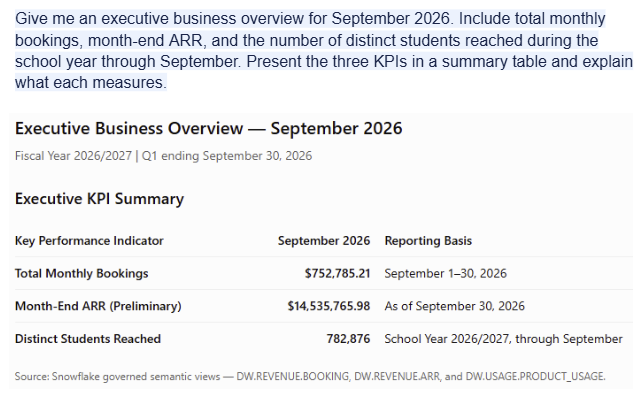
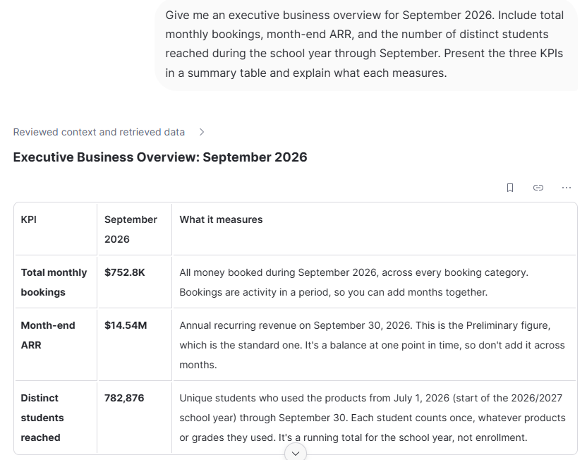
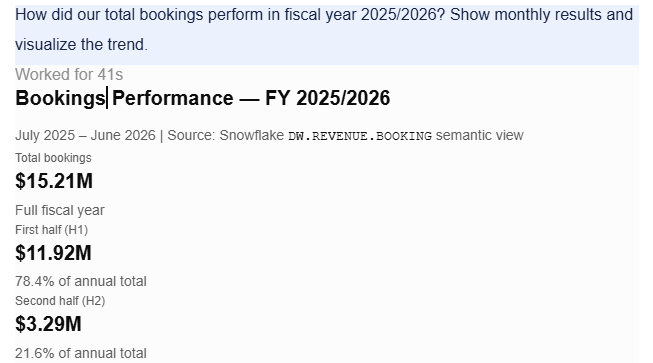
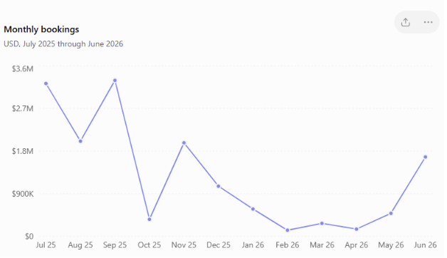
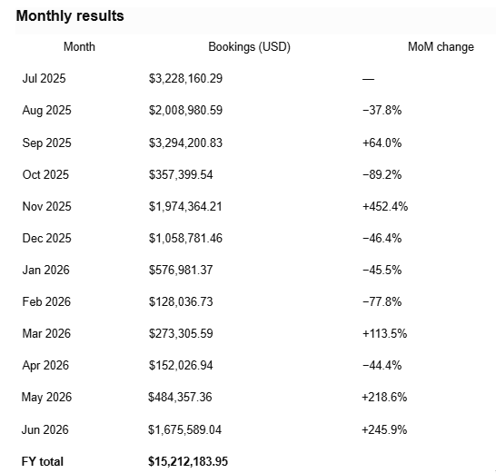
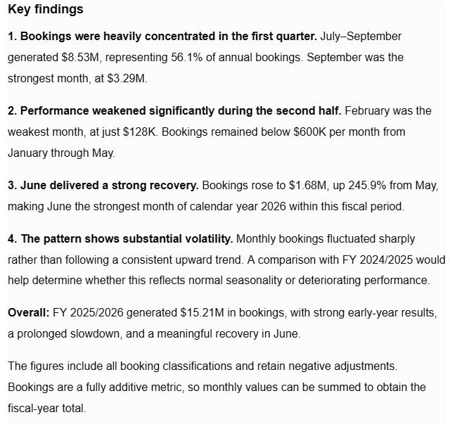
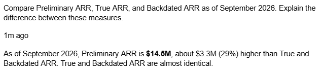
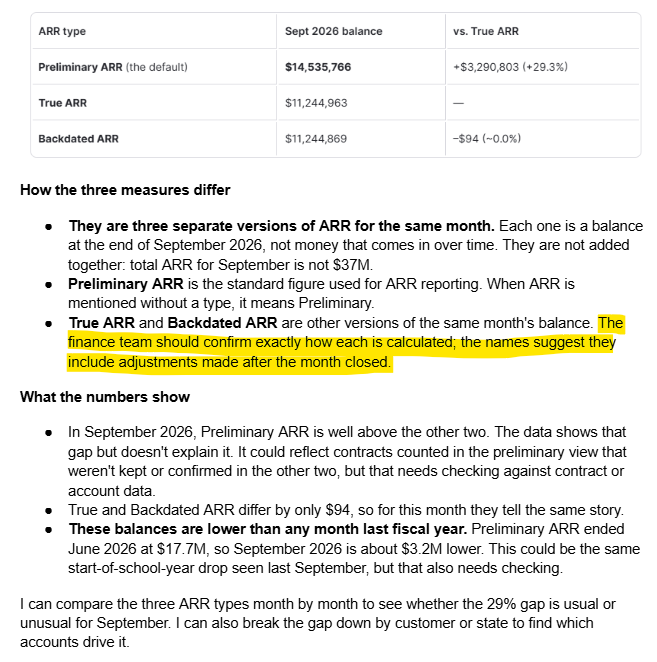
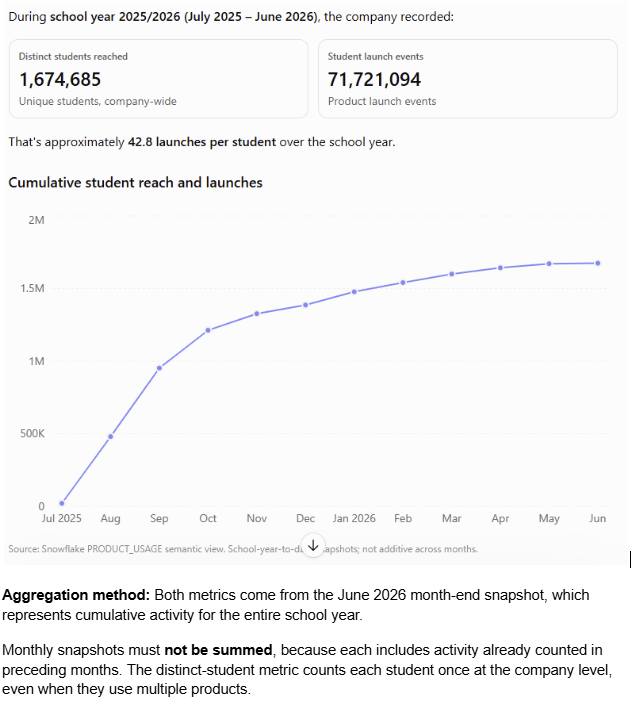
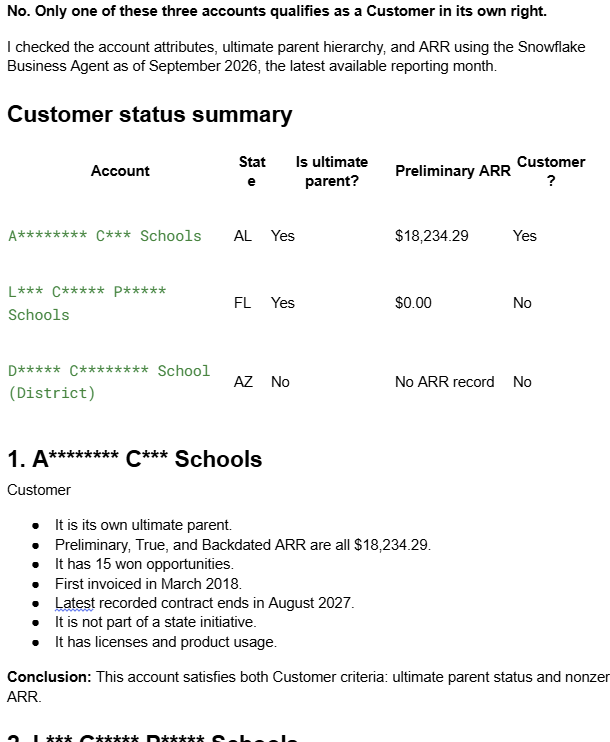

# End-to-End Demo: Governed Analytics in ChatGPT and Snowflake CoWork

[Project Overview](../README.md) · [Data Model](../data/README.md) · [Semantic Views](../semantic_views/README.md) · [Cortex Agent](../agent/README.md) · [Evaluation](../evaluation/README.md) · [MCP Integration](../mcp/README.md) · [Demo](../demo/README.md)

---

## Overview

This walkthrough demonstrates an implemented business analytics agent for an educational SaaS company, tested in **Snowflake CoWork** and **ChatGPT**. Both clients use the Snowflake Cortex Agent and its governed business definitions. ChatGPT accesses the agent through a Snowflake-managed MCP server with OAuth authentication; it does not require a separately hosted MCP application.

The goal is to demonstrate more than natural-language-to-SQL generation. The agent must select the correct metric, respect its aggregation rules and reporting period, use business context where necessary, and explain the result in terms a business user can understand.

The examples below are from the project's November 2026 test sessions, using warehouse data available through **September 2026**. The figures are snapshots of the source environment, not a live public demo. Source data and credentials are not included in this repository; account names shown in examples are masked  and metric values are modified for demonstration purposes. While the data does not represent actual business performance, the architecture, semantic models, business rules, and AI interactions reflect a working implementation.

### What the scenarios exercise

| Scenario | Main capability |
| --- | --- |
| Executive KPI overview | Combine results from three different semantic views without joining incompatible fact grains |
| Fiscal-year bookings | Sum a fully additive flow metric across months and categories |
| ARR comparison | Distinguish three versions of a semi-additive month-end balance |
| Student engagement | Use pre-aggregated distinct counts and cumulative school-year snapshots |
| Customer versus product user | Combine account hierarchy attributes with separately retrieved ARR evidence |

## 1. Executive overview: one question, three semantic views

**ChatGPT:**

The important distinction is the **different grain and time basis** of each result. Bookings measure activity during a month, ARR measures a balance at month-end, and student reach measures cumulative distinct users since the July start of the school year. The agent queries the appropriate semantic views separately and synthesizes the answer; it does not equate or directly join the three measures.

**The same question was also tested in Snowflake CoWork:**

## 2. Bookings: a fully additive financial measure

Monthly booking amounts were aggregated to produce the fiscal-year total. The agent identified strong activity in the first fiscal quarter, a decline in the spring, and a June recovery.

A follow-up question broke bookings down by category. **Renewal: ARR** and **Renewal: Biz Dev** together represented approximately **85.1%** of fiscal-year bookings.

**Why this matters:** Bookings are a *flow* metric. Given the model's supported grain and aggregation rules, monthly booking amounts can be summed across the fiscal year. That operation would not be valid for ARR or cumulative distinct-student snapshots.

## 3. ARR: three interpretations of a month-end balance

**Business knowledge test:** An early CoWork response retrieved the correct balances but did not fully explain the three ARR definitions. 

Following an update to the `financial-metric-interpretation` skill and publication of an updated agent version, a subsequent test explained confirmation timing, preliminary renewal grace periods, and Backdated ARR's rolling historical adjustment window more precisely. 

See [Cortex Agent](../agent/README.md) for the skill design and [Semantic Views](../semantic_views/README.md) for metric aggregation rules.

## 4. Student engagement: distinct users are non-additive

**Prompt**

> How many distinct students did we reach during school year 2025/2026? How many student launch events were recorded?

A student can use multiple products or appear in multiple schools, districts, states or grade levels. Adding those distinct counts would risk double counting. The semantic model therefore provides separately calculated measures for each organizational level and selects the correct school-year-to-date snapshot.

**Why this matters:** The company-wide student total is not calculated by summing school, district or state distinct-student totals. Launches measure events, not distinct users; the modeled launch metrics also represent cumulative snapshots and must not be summed across months.

## 5. Customer identity: commercial relationships are not product usage

**Prompt**

> Are all three of these accounts Customers? A******** C*** Schools; L*** C***** P***** Schools; D***** C******** School (District).

The agent uses the **`account_lookup`** custom tool to retrieve account identity, hierarchy and contextual attributes, then separately queries **the ARR semantic view** to evaluate the financial part of the customer definition. The custom lookup does not calculate ARR or determine customer status by itself.

An account's state-initiative flag may help explain why it has product access but **does not identify the actual payer**. Contract evidence would be required to establish which organization funds that access. Product usage alone cannot prove customer status.

See [Cortex Agent](../agent/README.md) for the documented reasoning workflow.

## What the demo demonstrates and what it does not

The examples demonstrate an end-to-end path from a business question through the Cortex Agent, semantic and contextual tools, and a readable answer in **two interfaces**. They also illustrate why a semantic layer alone is not enough: domain knowledge about fiscal years, renewal timing, customer hierarchies and distinct-count grain matters to interpretation.

The observed tests are **not** a claim of perfect tool selection or reasoning. ChatGPT and CoWork can produce different wording, charts and tool sequences even when using the same Snowflake agent. The 15-question agent evaluation is a separate baseline experiment, and the source warehouse is not distributed for independent reproduction.

## Related documentation

- [Semantic Views](../semantic_views/README.md) metrics, aggregation behavior and verified queries.
- [Cortex Agent](../agent/README.md) tools, skills, customer reasoning and agent configuration.
- [Evaluation](../evaluation/README.md) reference questions, validation and limitations.
- [MCP Integration](../mcp/README.md) managed server, OAuth and ChatGPT connection.
- [Data Model](../data/README.md) supporting dimensional model.

---

[Back to Project Overview](../README.md)
