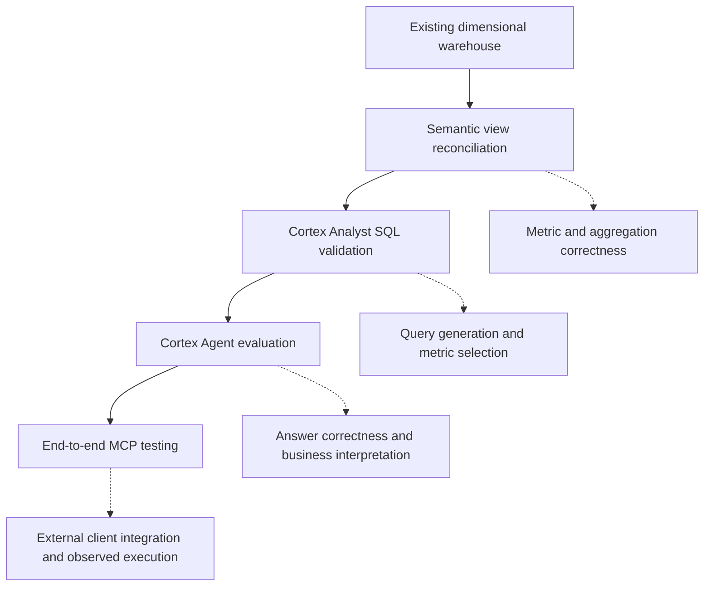
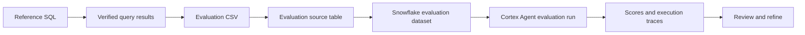
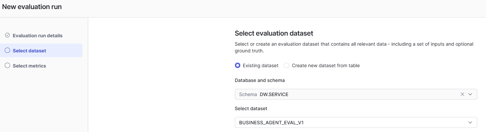
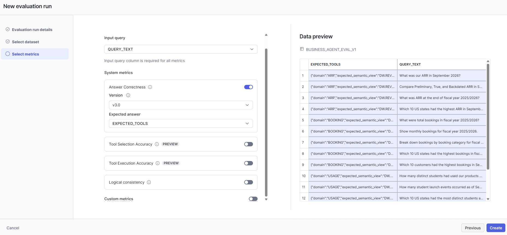
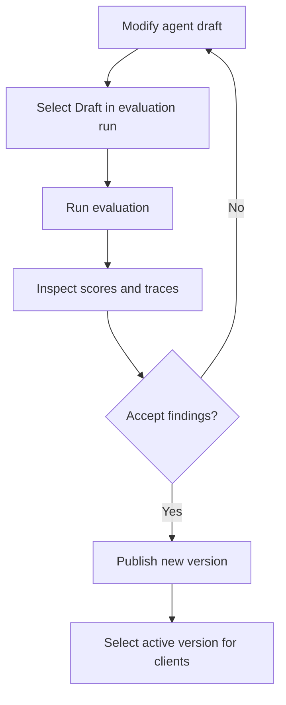
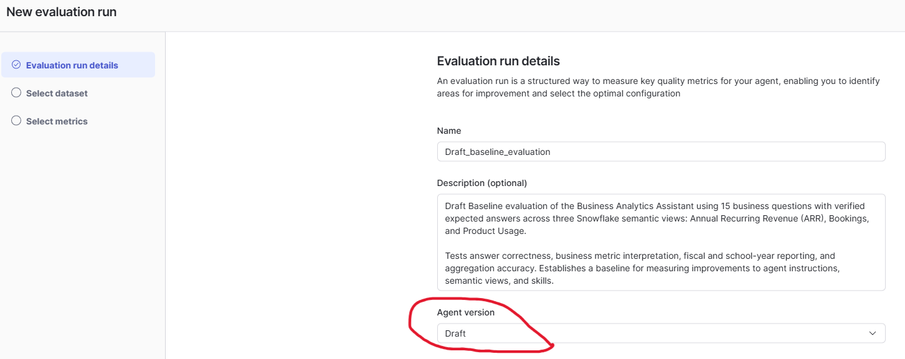
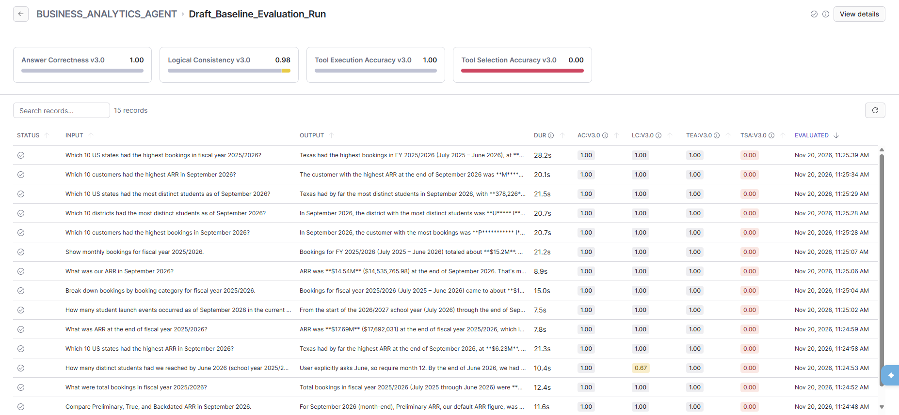
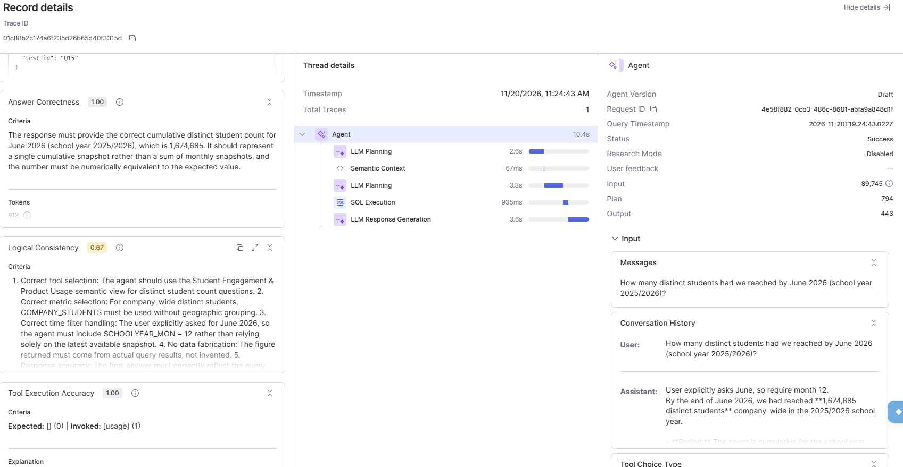

# Analytics Agent Evaluation and Semantic Model Validation

[Project Overview](../README.md) · [Data Model](../data/README.md) · [Semantic Views](../semantic_views/README.md) · [Cortex Agent](../agent/README.md) · [Evaluation](../evaluation/README.md) · [MCP Integration](../mcp/README.md) · [Demo](../demo/README.md) · [Production Roadmap](../production/README.md)

---
## Evaluation Scope

This project prioritizes agent-level evaluation because Cortex Agent generates SQL within its own orchestration context,
including business instructions, skills, and tool selection.

Standalone Cortex Analyst evaluations of individual semantic views are optional diagnostic tests useful for isolating SQL generation issues, but they do not fully represent the agent's
end-to-end behavior.

Semantic metric correctness is validated separately through deterministic SQL reconciliation tests.

## 1. Evaluation strategy

A business analytics agent must do more than generate executable SQL. It must retrieve the correct governed metric, respect its aggregation behavior and reporting calendar, select the appropriate tools, and interpret the result in accordance with business definitions.

This project separates four levels of validation. Each level addresses a different source of error; success at one level does not guarantee success at the next.



| Level | Evidence | Purpose |
|---|---|---|
| Semantic model | Source-to-semantic reconciliation | Verify metric values and aggregation behavior |
| Cortex Analyst | Generated SQL, verified queries and monitoring | Verify query construction and semantic context |
| Cortex Agent | Evaluation dataset and record-level traces | Assess answers, reasoning and tool use |
| MCP integration | ChatGPT responses and Snowflake query history | Observe external access and end-to-end behavior |

The populated warehouse is a prerequisite. Source data and ingestion pipelines are outside the repository scope. The evaluation artifacts document an implemented experiment rather than a standalone benchmark that can be reproduced without the original dataset.

## 2. Semantic model reconciliation

Before evaluating natural-language answers, the semantic views must be checked against independently constructed queries over their supporting fact and dimension data.

| Domain | Reconciliation objective |
|---|---|
| Booking | Match monthly and fiscal-year totals using additive booking flows, including adjustments. |
| ARR | Match each ARR type at the requested month-end; confirm fiscal year-end selection and the default Preliminary ARR metric. |
| Product Usage distinct students | Match the precomputed count at the requested organizational level, snapshot, grade and product grain. |
| Product Usage launches | Match cumulative launch totals using geographic summation and appropriate month, grade and product rollups. |

The custom fiscal and school-year calendars begin in July and end in June. A fiscal-year booking total accumulates twelve months of activity, whereas fiscal-year-end ARR and school-year-end usage select the June snapshot. An incomplete year may instead require the latest available snapshot, depending on the question.


See [Semantic Views](../semantic_views/README.md) for the aggregation model.


## 3. Cortex Analyst validation

Cortex Analyst translates natural-language requests into SQL using the selected semantic view. Validation focuses on the generated statement rather than only the displayed answer.

Checks include metric selection, dimension selection, filters, custom calendar handling, snapshot selection, ranking, and the use of verified queries. Additional SQL around `SEMANTIC_VIEW()` may implement calculations such as month-over-month change or share of total without redefining the underlying metric.

The verified queries embedded in the semantic view definitions guide SQL generation. They are distinct from the evaluation dataset and its reference queries. Overlap between these sets makes this a baseline functional evaluation, rather than a held-out test of generalization.

## 4. Cortex Agent evaluation dataset

The baseline consists of **15 natural-language questions**, five per semantic domain. Expected answers were populated from user-verified reference query results. Each case also includes a domain, semantic view, reference query identifier and business evaluation criteria.



### Test coverage

| ID | Domain | Question / analytical task | Expected behavior |
|---|---|---|---|
| Q01 | ARR | September 2026 ARR | Default to Preliminary ARR; one month-end balance |
| Q02 | ARR | Compare three ARR types in September 2026 | Three separate balances at the same snapshot |
| Q03 | ARR | FY 2025/2026 ending ARR | June 2026 snapshot; fiscal month 12 |
| Q04 | ARR | Top 10 US states by September ARR | Rank state-level ARR in descending order |
| Q05 | ARR | Top 10 customers by September ARR | Group by customer, not individual account |
| Q06 | Booking | Total FY 2025/2026 bookings | Sum July-June booking flows |
| Q07 | Booking | Monthly FY 2025/2026 bookings | Twelve months in fiscal order |
| Q08 | Booking | Fiscal-year bookings by category | Use stored `BUCKET` categories |
| Q09 | Booking | Top 10 US states by fiscal-year bookings | Rank additive fiscal-year totals |
| Q10 | Booking | Top 10 customers by September bookings | Group by customer; sum September flows |
| Q11 | Usage | Distinct students through September 2026 | `COMPANY_STUDENTS`, school-year-to-date |
| Q12 | Usage | Launch events through September 2026 | `STUDENTS_LAUNCHES`, cumulative events |
| Q13 | Usage | Top 10 US states by distinct students | `STATE_STUDENTS`, not summed district counts |
| Q14 | Usage | Top 10 districts by distinct students | `DISTRICT_STUDENTS`, grouped by district ID and name |
| Q15 | Usage | Distinct students by June 2026 | `COMPANY_STUDENTS`, explicit final school-year snapshot |

### Reference SQL and expected answers

The reference queries call the implemented semantic views directly. They establish expected semantic-layer outputs for the agent; they are not independent tests of underlying fact-table accuracy.

For example, Q03 requires an explicit fiscal year-end balance:

```sql
SELECT ARR
FROM SEMANTIC_VIEW(
    DW.REVENUE.ARR
    METRICS ARR
    WHERE DIM_MONTH.FISCALYEAR = '2025/2026'
      AND DIM_MONTH.FISCALYEAR_MON = 12
);
```

Q12 requests cumulative launch events through September, not September-only activity:

```sql
SELECT STUDENTS_LAUNCHES
FROM SEMANTIC_VIEW(
    DW.USAGE.PRODUCT_USAGE
    METRICS u.STUDENTS_LAUNCHES
    WHERE u.MON_YEAR = 202609
);
```

The expected-answer criteria permit appropriate formatting and numerically equivalent compact notation. Ranked outputs also require the correct entities, ordering and values. The stored answers are tied to the original data snapshot and may become stale if the warehouse changes.

One reference-query limitation is that Q04 and Q09 exclude `Unknown` state codes but do not explicitly restrict the result to the 50 US states. The wording says US states; an explicit allowed-state filter would make these cases more robust. Q13 already filters the country to `United States of America`.

## 5. Creating the Snowflake evaluation dataset

The repository includes an SQL script that creates and populates the evaluation source table:

```sql
CREATE OR REPLACE TABLE DW.SERVICE.BUSINESS_AGENT_EVAL_SOURCE (
    INPUT_QUERY VARCHAR,
    GROUND_TRUTH VARIANT
);
```

The `GROUND_TRUTH` object in the existing implementation includes:

| Field | Purpose |
|---|---|
| `ground_truth_output` | Expected numerical answer and business evaluation requirements |
| `test_id` | Stable case identifier, Q01-Q15 |
| `domain` | ARR, BOOKING or USAGE |
| `expected_semantic_view` | Intended semantic data source (custom metadata) |

The existing script inserts all 15 cases, checks the record count and missing answers, and registers the evaluation dataset using the following call:

```sql
CALL SYSTEM$CREATE_EVALUATION_DATASET(
    'Cortex Agent',
    'DW.SERVICE.BUSINESS_AGENT_EVAL_SOURCE',
    'DW.SERVICE.BUSINESS_AGENT_EVAL_V1',
    OBJECT_CONSTRUCT(
        'query_text', 'INPUT_QUERY',
        'expected_tools', 'GROUND_TRUTH'
    )
);
```

The dataset can then be selected from the agent's Evaluations interface. The archived script is provided as an implementation reference, not an installation requirement for this repository.



## 6. Evaluation metrics and agent version

The captured runs use four Snowflake evaluation metrics (v3.0 in the detailed draft run):

| Metric | Interpretation in this project |
|---|---|
| Answer Correctness | Whether the answer satisfies the expected output and numerical requirements |
| Logical Consistency | Whether the reasoning and analytical approach satisfy the evaluation criteria |
| Tool Execution Accuracy | Whether tool execution satisfies the configured evaluator; not independent proof of correct metric selection |
| Tool Selection Accuracy | Whether invoked tools match configured expected invocations |



### Draft versus published version

Agent configuration is versioned. Use 'Draft' in evaluation not-published version. When comparing runs, record the agent version, dataset, metric versions and instructions used. Publish a new version only after reviewing the evaluated draft.



 

## 7. Observed evaluation results

The detailed `Draft_Baseline_Evaluation_Run` screenshot from November 20, 2026 shows 15 records and the following run-level scores:

| Metric | Recorded score |
|---|---:|
| Answer Correctness v3.0 | 1.00 |
| Logical Consistency v3.0 | 0.98 |
| Tool Execution Accuracy v3.0 | 1.00 |
| Tool Selection Accuracy v3.0 | 0.00 |

These are the scores displayed by Snowflake for this specific draft run, not independently computed accuracy statistics. 



### Why Tool Selection Accuracy was zero

The existing evaluation JSON stores the intended semantic view in `expected_semantic_view`, but does not explicitly specify expected tool invocations. The Q15 record details show:

```text
Expected: [] (0) | Invoked: [usage] (1)
```

The `usage` invocation is consistent with the intended Product Usage domain. The empty expected-tool list suggests that the evaluator was not supplied with an expected invocation in the format it recognizes. Thus the zero score cannot be interpreted as evidence that all questions were routed incorrectly. Equally, it cannot be replaced with a passing score without correcting the evaluation configuration and rerunning the test.

A future tool-routing benchmark should explicitly register the expected tool names using the supported evaluation schema, verify their correspondence with the configured agent tools, and inspect the actual invocation trace.

### Record-level review: Q15

The question requests the distinct student population by June 2026, the final month of school year 2025/2026. The answer correctly returned the stored company-wide cumulative count. The record shows Answer Correctness 1.00, Logical Consistency 0.67 and Tool Execution Accuracy 1.00.

The logical consistency criteria include selection of the company-level metric without geographic grouping and an explicit June / school-year-month-12 filter. The lower logical-consistency score warrants inspection of the full SQL and evaluator explanation; the screenshot alone does not establish exactly which criterion failed. A correct final number can coexist with an imperfect analytical approach or a stricter grading criterion.

The execution trace also shows an end-to-end agent duration of 10.4 seconds and a SQL execution step of 935 ms. These are separate latency measures: orchestration and response generation contribute to the overall response time.



## 8. End-to-end evaluation through MCP

The later November 24, 2026 ChatGPT session tested the published integration through the managed MCP server. Unlike the 15-question baseline, this was an interactive exploratory test with follow-up questions, chart requests, cross-domain reporting, and customer classification.

Examples include:

- Executive overview combining bookings, month-end ARR and school-year-to-date student reach from three semantic views.
- Comparison and selection of ARR types for different business reporting purposes.
- Distinguishing paying customers from product users and state-funded participants using account attributes plus governed ARR values.
- Preservation of reporting context across conversational follow-ups.

The MCP tests provide evidence of the implemented execution path and business capabilities. They were not scored using the same formal evaluation dataset; no combined accuracy score is claimed.


## 9. Limitations and potential evaluation extensions

The baseline provides a useful functional check of all three semantic domains, but does not measure generalization to unseen questions, multi-turn accuracy, or comprehensive tool routing. The reference answers use the same semantic views available to the agent, and some questions overlap with verified queries. Upstream data correctness and model reconciliation remain separate concerns.

For future runs, maintain separate results for numerical correctness, logical consistency, tool routing and execution, and record the evaluated version and data snapshot. A small held-out set and explicit expected tool invocations would strengthen the benchmark without changing the project's scope.

## 10. Repository artifacts

| File | Purpose |
|---|---|
| [agent_eval_questions.csv](agent_eval_questions.csv) | Fifteen questions, expected answers and evaluation criteria |
| [agent_eval_reference_queries.sql](agent_eval_reference_queries.sql) | Reference semantic SQL, indexed by test ID |
| [business_analytics_agent_evaluation.sql](business_analytics_agent_evaluation.sql) | Evaluation source table and dataset creation |


---

[Back to Project Overview](../README.md)
