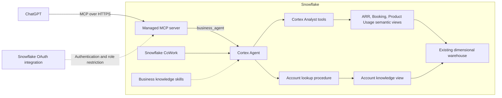
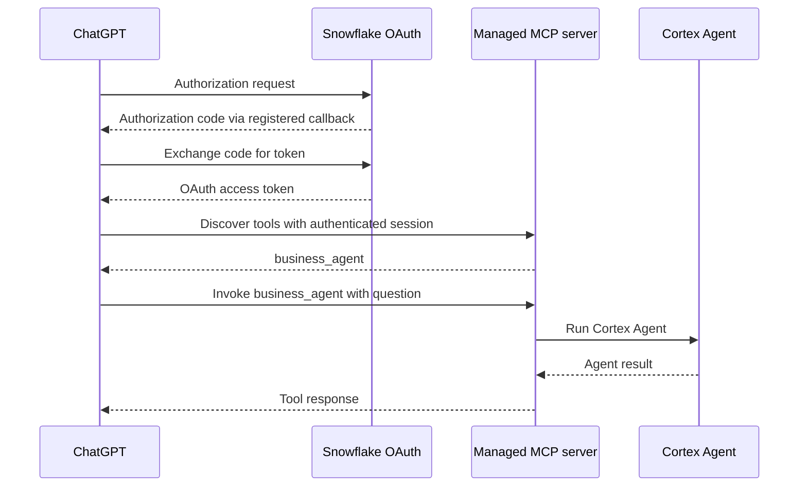
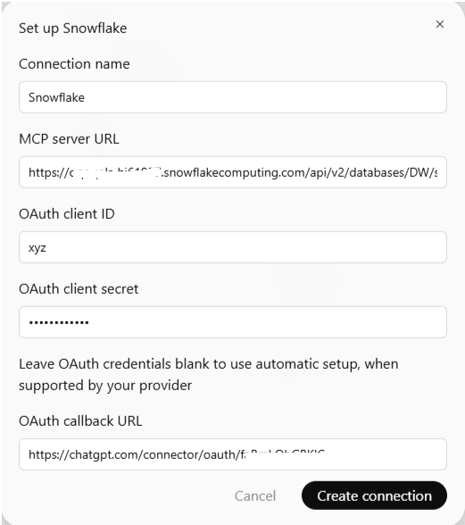
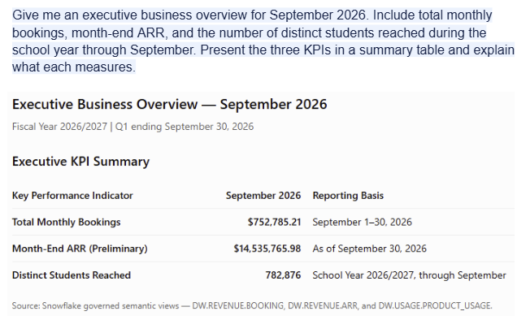

# Snowflake-Managed MCP Server External AI Integration

[Project Overview](../README.md) · [Data Model](../data/README.md) · [Semantic Views](../semantic_views/README.md) · [Cortex Agent](../agent/README.md) · [Evaluation](../evaluation/README.md) · [MCP Integration](../mcp/README.md) · [Demo](../demo/README.md)

---

## 1. Purpose and scope

This component exposes the existing Snowflake business analytics agent to external MCP-compatible AI clients, including ChatGPT, which is used in this project, through a Snowflake-managed Model Context Protocol (MCP) server. The objective is to demonstrate how an external AI client can use the same governed metrics, business context and analytical tools as the agent available within Snowflake CoWork.

The MCP server is an integration boundary, not another semantic layer or another independently implemented analytics agent. No separately hosted Python MCP service is required. The dimensional warehouse, semantic views, Cortex Agent and its custom tools are assumed to exist before this integration is configured.

The connection was tested on November 24, 2026. This repository documents a demonstrated implementation, not a standalone deployment package. Source datasets and live credentials are not distributed.

## 2. Architecture and responsibilities



| Component | Responsibility |
| --- | --- |
| ChatGPT | External conversational interface; invokes the MCP tool and presents or further interprets results |
| Snowflake OAuth | Authenticates the connection and restricts the authorized session role |
| Managed MCP server | Publishes the configured Cortex Agent as an MCP tool |
| Cortex Agent | Orchestrates analytical retrieval, custom tools and business-context interpretation |
| Cortex Analyst | Generates SQL using the configured semantic views |
| Semantic Views | Define governed metrics, dimensions, relationships and aggregation semantics |
| Custom account lookup | Retrieves organizational attributes for business reasoning |

The Snowflake agent is reused rather than reimplemented for each client. However, the external client has its own orchestration and response generation. Identical underlying metrics do not guarantee identical narratives, tool invocation patterns or reasoning in both interfaces.

## 3. MCP server specification

The managed server is a Snowflake schema object: `DW.SERVICE.BUSINESS_MCP`. It exposes one MCP tool, `business_agent`, which points to the existing agent `DW.SERVICE.BUSINESS_ANALYTICS_AGENT`.

```sql
CREATE OR REPLACE MCP SERVER DW.SERVICE.BUSINESS_MCP
FROM SPECIFICATION $$
tools:
  - name: "business_agent"
    type: "CORTEX_AGENT_RUN"
    identifier: "DW.SERVICE.BUSINESS_ANALYTICS_AGENT"
    title: "Business Analytics Agent"
    description: >
      Answers business questions about bookings,
      ARR, product usage, and customer status.
      Uses the governed Snowflake Cortex Agent
      and its semantic views and business rules.
$$;
```

The example reflects the project specification with a minor description typo corrected. Inspect existing objects before replacing them.

| MCP configuration | Value |
| --- | --- |
| Server | `DW.SERVICE.BUSINESS_MCP` |
| Exposed tool | `business_agent` |
| Tool type | `CORTEX_AGENT_RUN` |
| Target agent | `DW.SERVICE.BUSINESS_ANALYTICS_AGENT` |

The server does not expose a generic SQL execution tool or register each semantic view as a separate MCP tool. Instead, the external client delegates a business question to the agent, which selects its own internal tools. The `ACCOUNT_QUERY` stored procedure remains an agent tool, not a separate public MCP endpoint.

This is a deliberate design choice: the external interface exposes business analytical capabilities rather than requiring the client to know the warehouse schema or coordinate every underlying data request itself.

Inspect the configured server with:

```sql
SHOW MCP SERVERS IN SCHEMA DW.SERVICE;
DESCRIBE MCP SERVER DW.SERVICE.BUSINESS_MCP;
```

## 4. Authentication and access control

The project uses a custom confidential Snowflake OAuth client and a dedicated Snowflake user and role. Authentication and authorization are separate concerns: OAuth establishes the session, while Snowflake object privileges determine which resources the session may use.

| Security object | Project identifier |
| --- | --- |
| OAuth security integration | `CHATGPT_MCP_OAUTH` |
| Dedicated user | `CHATGPT_MCP_USER` |
| Access role | `CHATGPT_MCP_READER` |
| Observed execution warehouse | `SNOWFLAKE_LEARNING_WH` |

The intended permissions are read-oriented and scoped to the agent and its dependencies:

- Cortex Agent and Cortex Analyst database roles.
- Warehouse usage and usage on the relevant database and schemas.
- Usage on the MCP server and the Cortex Agent.
- References and select privileges on the three semantic views, with underlying resource access granted only where required.
- Usage on the `ACCOUNT_QUERY(VARCHAR, VARCHAR, VARCHAR)` procedure.

The integration restricts authorized roles to `CHATGPT_MCP_READER` and disables secondary roles for the OAuth session. The dedicated user's default role is also `CHATGPT_MCP_READER`.

```sql
CREATE SECURITY INTEGRATION CHATGPT_MCP_OAUTH
    TYPE = OAUTH
    ENABLED = TRUE
    OAUTH_CLIENT = CUSTOM
    OAUTH_CLIENT_TYPE = 'CONFIDENTIAL'
    OAUTH_REDIRECT_URI = '<CHATGPT_DISPLAYED_CALLBACK_URL>'
    OAUTH_USE_SECONDARY_ROLES = NONE
    ALLOWED_ROLES_LIST = ('CHATGPT_MCP_READER')
    OAUTH_ISSUE_REFRESH_TOKENS = TRUE;
```

The redirect URI is a placeholder, not a live configuration value. The connection guide explains how to obtain the actual callback.


## 5. Connecting ChatGPT

The tested integration used the Snowflake plugin connection form in ChatGPT. The server URL follows this pattern:

```text
https://<organization>-<account>.snowflakecomputing.com/api/v2/databases/DW/schemas/SERVICE/mcp-servers/BUSINESS_MCP
```

The client configuration requires the MCP endpoint, OAuth client credentials and correctly registered callback URI. The user signs in to Snowflake and authorizes the connection.



This diagram is a conceptual representation of the authorization and invocation flow, not a captured protocol trace.

 

### Practical finding: OAuth callback mismatch

During setup, the callback displayed in the ChatGPT connection form differed from the actual redirect URI sent to Snowflake. Snowflake rejected authorization because the redirect was not registered.

| Callback source | Observed pattern |
| --- | --- |
| Displayed in connection form | `https://chatgpt.com/connector/oauth/<generated-id>` |
| Sent in authorization request | `https://chatgpt.com/connector_platform_oauth_redirect` |

The successful fix was to register the actual platform callback as an alternate redirect URI while retaining the original callback:

```sql
ALTER SECURITY INTEGRATION CHATGPT_MCP_OAUTH
    SET OAUTH_ALTERNATE_REDIRECT_URIS = (
        'https://chatgpt.com/connector_platform_oauth_redirect'
    );
```

This was a finding from the tested environment, not a universal configuration requirement. Verify the actual redirect and preserve any existing legitimate alternate URIs before changing the list.

The full [Snowflake MCP ChatGPT connection guide](snowflake-mcp-chatgpt.md) documents provisioning, endpoint construction, credential setup, callback troubleshooting, HTTP discovery checks and connection testing. It is maintained separately to avoid duplicating the setup instructions here.

## 6. End-to-end analytical behavior

Once connected, ChatGPT can invoke `business_agent` for questions involving one or multiple analytical domains. The agent selects the relevant semantic views and, when needed, retrieves account attributes through its custom tool.

For example:

> Give me an executive business overview for September 2026. Include total monthly bookings, month-end ARR, and the number of distinct students reached during the school year through September.

The observed response combined three different reporting interpretations: monthly additive bookings, the September ending Preliminary ARR balance, and cumulative school-year-to-date distinct students. The metrics were not treated as equivalent monthly activity measures.




A second class of questions requires business interpretation rather than metric retrieval alone: for example, whether an account with product usage but no ARR qualifies as a paying customer. The agent can combine account lookup results with ARR data and the customer-context skill. Exact payer identity should not be inferred from a state initiative flag alone.

See [Agent architecture](../agent/README.md) for the reasoning workflow. 

## 7. Observed SQL execution and observability

The November 24, 2026 query-history analysis for `CHATGPT_MCP_USER` covered 47 recorded operations during a roughly 43-minute session.

| Operation | Count |
| --- | ---: |
| Queries using `SEMANTIC_VIEW()` | 18 |
| `RESULT_SCAN` queries | 5 |
| `ACCOUNT_QUERY` calls | 3 |
| Queries inside the account lookup procedure | 6 |
| Agent skill-file lookup operations | 15 |
| **Total** | **47** |

The recorded analytical SQL uses the semantic views, including ordinary SQL composed around `SEMANTIC_VIEW()` for additional analysis. The account lookup is a separate contextual retrieval path. The full SQL example in the query-history report also confirms that the account and customer CTEs  use the ARR semantic view.

A representative pattern, simplified from the observed bookings query, is:

```sql
WITH monthly AS (
    SELECT fiscalyear_mon, mon_year, booking
    FROM SEMANTIC_VIEW(
        dw.revenue.booking
        METRICS vw_fact_booking.booking
        DIMENSIONS dim_month.fiscalyear_mon, dim_month.mon_year
        WHERE dim_month.fiscalyear = '2025/2026'
    )
)
SELECT
    fiscalyear_mon,
    mon_year,
    booking,
    LAG(booking) OVER (ORDER BY fiscalyear_mon) AS previous_booking,
    SUM(booking) OVER () AS fiscal_year_total
FROM monthly
ORDER BY fiscalyear_mon;
```

This is an illustrative adaptation, not a verbatim captured query. The governed booking metric is evaluated inside the semantic query; ordinary SQL performs the additional analysis within the same statement. 


## 8. Validation and limitations

The tested connection established successful OAuth authorization, MCP tool discovery and business-question execution through ChatGPT. The query-history report provides evidence that semantic views were used in the observed analytical workload.

The evidence does not establish that every future agent-generated query will use semantic views, that every skill was loaded successfully, that all answers were correct, or that the external client and Snowflake CoWork produce identical interpretations. No formal latency benchmark or full security test is claimed.

For semantic model reconciliation, agent evaluation metrics and versioning, see [Evaluation](../evaluation/README.md).

## 9. Repository files

```text
mcp/
+-- README.md
+-- mcp_server.sql
+-- role_and_user.sql
+-- oauth_integration.sql
+-- snowflake-mcp-chatgpt.md
```

The SQL filenames follow the proposed lowercase repository layout; rename the archived scripts accordingly or adjust the references to match the final repository. The query execution analysis is not yet included.

## References

- [Snowflake-managed MCP server](https://docs.snowflake.com/en/user-guide/snowflake-cortex/cortex-agents-mcp)
- [CREATE MCP SERVER](https://docs.snowflake.com/en/sql-reference/sql/create-mcp-server)
- [Snowflake OAuth custom clients](https://docs.snowflake.com/en/user-guide/oauth-custom)
- [Snowflake MCP ChatGPT connection guide](snowflake-mcp-chatgpt.md)

---

[Back to Project Overview](../README.md)