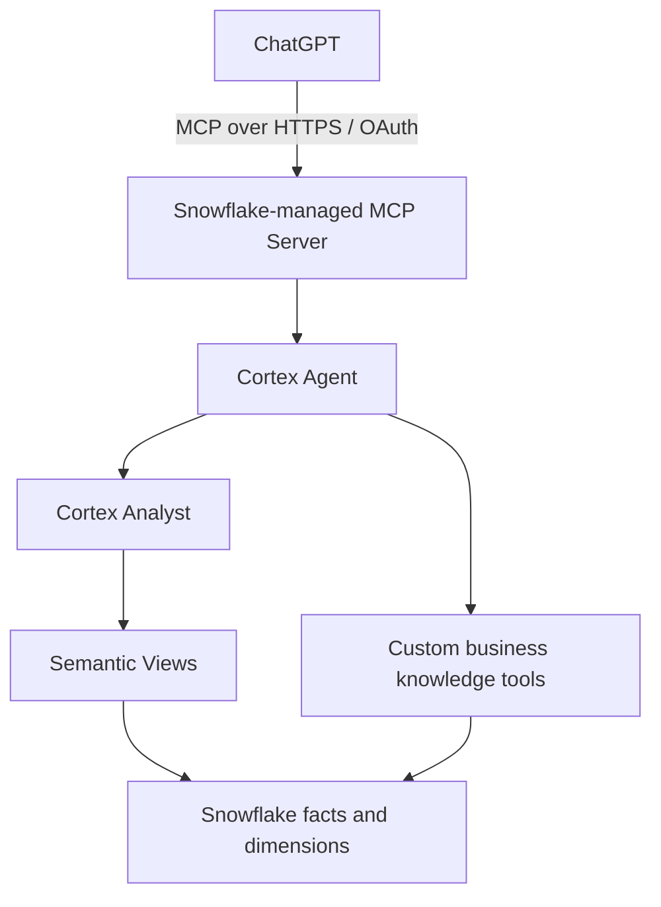
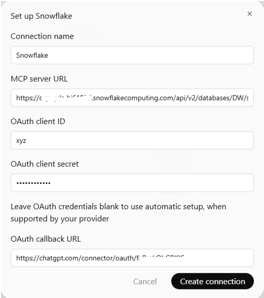

# Connecting a Snowflake-managed MCP Server to ChatGPT

[Project Overview](../README.md) · [Data Model](../data/README.md) · [Semantic Views](../semantic_views/README.md) · [Cortex Agent](../agent/README.md) · [Evaluation](../evaluation/README.md) · [MCP Integration](../mcp/README.md) · [Demo](../demo/README.md)

---

**Authentication:** Snowflake OAuth 2.0 (custom confidential client)  
**Client:** ChatGPT Snowflake Plugin  
**Validated:** November 24, 2026

This guide exposes an existing Snowflake Cortex Agent through a Snowflake-managed Model Context Protocol (MCP) server and connects it to ChatGPT. No separately hosted MCP service is required.

## Architecture



ChatGPT discovers the `business_agent` MCP tool and sends natural-language business questions to Cortex Agent. The agent uses its configured semantic views and business rules to retrieve and interpret governed data.

## 1. Prerequisites

- A Snowflake account with Cortex Agent and managed MCP server capabilities.
- An existing, tested Cortex Agent configured with the appropriate semantic views, instructions and custom tools.
- An existing warehouse and the `DW` database, including the `SERVICE`, `REVENUE`, `USAGE` and `COMMON` schemas used in this example.
- ChatGPT Plus or Pro, or an appropriately configured organizational workspace with the Snowflake template available.
- Snowflake administrative privileges to provision the role, MCP server and security integration.

The SQL below is a reusable setup example. Replace `<AGENT_NAME>`, `<WAREHOUSE_NAME>`, `<USERNAME>` and other angle-bracket placeholders with actual identifiers or values before execution. The exact stored Cortex Agent name and warehouse are deployment-specific; `business_agent` is the MCP tool name, not necessarily the stored agent name. If objects already exist, inspect and reuse them rather than replacing them.

## 2. Create the Snowflake-managed MCP server

Find the existing agent:

```sql
SHOW AGENTS IN DATABASE DW;
```

Using a provisioning role with the required privileges, create the server in the existing service schema. Replace the agent identifier with its actual fully qualified name, including its schema if different from `SERVICE`.

```sql
CREATE MCP SERVER IF NOT EXISTS DW.SERVICE.BUSINESS_MCP
FROM SPECIFICATION $$
tools:
  - name: "business_agent"
    title: "Business Analytics Agent"
    type: "CORTEX_AGENT_RUN"
    identifier: "DW.SERVICE.<AGENT_NAME>"
    description: "Answers business questions about bookings, ARR, product usage, and customer status. Uses the governed Snowflake Cortex Agent and its semantic views and business rules."
$$;
```

Verify the configuration:

```sql
SHOW MCP SERVERS IN SCHEMA DW.SERVICE;
DESCRIBE MCP SERVER DW.SERVICE.BUSINESS_MCP;
```

This server exposes the existing agent, not an unrestricted SQL execution tool. Review the agent's own tools to ensure that they do not perform unauthorized writes.

## 3. Create a dedicated read-only access role

Execute grants using an administrative or object-owning role authorized to grant the privileges.

```sql
CREATE ROLE IF NOT EXISTS CHATGPT_MCP_READER;

GRANT DATABASE ROLE SNOWFLAKE.CORTEX_AGENT_USER
    TO ROLE CHATGPT_MCP_READER;

GRANT USAGE ON WAREHOUSE <WAREHOUSE_NAME>
    TO ROLE CHATGPT_MCP_READER;

GRANT USAGE ON DATABASE DW
    TO ROLE CHATGPT_MCP_READER;

GRANT USAGE ON SCHEMA DW.SERVICE
    TO ROLE CHATGPT_MCP_READER;

GRANT USAGE ON MCP SERVER DW.SERVICE.BUSINESS_MCP
    TO ROLE CHATGPT_MCP_READER;

GRANT USAGE ON AGENT DW.SERVICE.<AGENT_NAME>
    TO ROLE CHATGPT_MCP_READER;
```

Adjust the agent schema in the grant if necessary and grant `USAGE` on that schema too.

### Grant access to the agent's resources

The MCP server grant alone does not grant access to the agent's data. Grant access only to objects actually used by the agent.

```sql
GRANT USAGE ON SCHEMA DW.REVENUE TO ROLE CHATGPT_MCP_READER;
GRANT USAGE ON SCHEMA DW.USAGE TO ROLE CHATGPT_MCP_READER;
GRANT USAGE ON SCHEMA DW.COMMON TO ROLE CHATGPT_MCP_READER;

SHOW SEMANTIC VIEWS IN DATABASE DW;

GRANT SELECT ON SEMANTIC VIEW DW.REVENUE.BOOKING
    TO ROLE CHATGPT_MCP_READER;

GRANT SELECT ON SEMANTIC VIEW DW.REVENUE.ARR
    TO ROLE CHATGPT_MCP_READER;

GRANT SELECT ON SEMANTIC VIEW DW.USAGE.PRODUCT_USAGE
    TO ROLE CHATGPT_MCP_READER;
```

Confirm the semantic view names against your deployed agent.


Confirm actual object types before granting. If using the account lookup stored procedure, grant its exact signature:

```sql
GRANT USAGE ON PROCEDURE DW.SERVICE.ACCOUNT_QUERY(VARCHAR, VARCHAR, VARCHAR)
    TO ROLE CHATGPT_MCP_READER;
```

For an owner-rights procedure, audit its implementation and owner permissions; the caller's read-only role alone does not guarantee read-only behavior inside the procedure.

Do not grant write privileges, administrative roles, or unrestricted access to all future tables merely to make MCP work.

## 4. Configure the Snowflake user

Use an existing dedicated human-login user, or provision one according to your organization's authentication policy. Example for a new human user:

```sql
CREATE USER IF NOT EXISTS <USERNAME>
    TYPE = PERSON
    DEFAULT_ROLE = CHATGPT_MCP_READER
    DEFAULT_WAREHOUSE = <WAREHOUSE_NAME>;
```

Configure the user's supported interactive authentication (SSO or an administrator-provisioned password and MFA, as applicable) before attempting to connect. The statement above does not establish login credentials by itself.

```sql
GRANT ROLE CHATGPT_MCP_READER TO USER <USERNAME>;

ALTER USER <USERNAME> SET
    DEFAULT_ROLE = CHATGPT_MCP_READER
    DEFAULT_WAREHOUSE = <WAREHOUSE_NAME>;

DESCRIBE USER <USERNAME>;
SHOW GRANTS TO USER <USERNAME>;
SHOW GRANTS TO ROLE CHATGPT_MCP_READER;
```

The default role matters because the MCP OAuth flow requests `session:role:all`. Despite its name, this scope selects the user's default primary role; it does not enable all roles.

## 5. Construct the MCP server URL

```sql
SELECT CURRENT_ORGANIZATION_NAME() AS ORGANIZATION_NAME,
       CURRENT_ACCOUNT_NAME() AS ACCOUNT_NAME;

SELECT 'https://' || LOWER(REPLACE(
    CURRENT_ORGANIZATION_NAME() || '-' || CURRENT_ACCOUNT_NAME(), '_', '-'))
    || '.snowflakecomputing.com/api/v2/databases/DW/schemas/SERVICE/mcp-servers/BUSINESS_MCP'
    AS MCP_SERVER_URL;
```

The result should follow this format:

```text
https://<organization>-<account>.snowflakecomputing.com/api/v2/databases/DW/schemas/SERVICE/mcp-servers/BUSINESS_MCP
```

Use the public Snowflake account hostname, not the Snowsight browser URL. Verify that the generated hostname is correct for your deployment. Replace underscores in the hostname with hyphens.

## 6. Open the Snowflake connection form in ChatGPT

1. Open ChatGPT **Settings → Plugins**.
2. Search for **Snowflake** and enable/open **Snowflake - Official Template** (the Snowflake plugin may surface this connection form directly).
3. Click **Connect**.
4. Enter a connection name, if requested, and paste the full MCP server URL from Step 5.
5. Choose custom OAuth if the interface provides that option.
6. Copy the displayed OAuth Callback URL. In the tested personal-account interface, the callback appeared only after text was entered into an OAuth credential field. If necessary, temporarily enter a non-secret placeholder to reveal it, then replace it with the real credentials before submitting.

**UI variation:** The official documentation describes an Advanced OAuth settings section and a token endpoint authentication method selector. Neither was displayed in the tested plugin form. Do not look for or require those controls if they are absent.

Keep this connection form open. Recreating the connection may generate a different callback URL.

 

*Oath Callback URL becomes visible only after populating OATH Client ID*

## 7. Create the Snowflake OAuth security integration

Use a role with the global `CREATE INTEGRATION` privilege. Register the exact callback copied from ChatGPT, not the illustrative placeholder below.

```sql
CREATE SECURITY INTEGRATION IF NOT EXISTS CHATGPT_MCP_OAUTH
    TYPE = OAUTH
    ENABLED = TRUE
    OAUTH_CLIENT = CUSTOM
    OAUTH_CLIENT_TYPE = 'CONFIDENTIAL'
    OAUTH_REDIRECT_URI = '<CHATGPT_DISPLAYED_CALLBACK_URL>'
    OAUTH_ISSUE_REFRESH_TOKENS = TRUE
    OAUTH_USE_SECONDARY_ROLES = NONE
    ALLOWED_ROLES_LIST = ('CHATGPT_MCP_READER');
```

If the integration already exists, verify it and update the primary callback only if necessary:

```sql
DESCRIBE SECURITY INTEGRATION CHATGPT_MCP_OAUTH;

-- Only if the displayed callback has changed:
ALTER SECURITY INTEGRATION CHATGPT_MCP_OAUTH
    SET OAUTH_REDIRECT_URI = '<CHATGPT_DISPLAYED_CALLBACK_URL>';
```

Verify `ENABLED`, `OAUTH_CLIENT_TYPE`, `OAUTH_REDIRECT_URI`, `ALLOWED_ROLES_LIST`, and `OAUTH_USE_SECONDARY_ROLES`. Keep administrative roles blocked. No new network policy was needed in the tested public-endpoint setup; existing organizational network restrictions still apply.

Retrieve the OAuth credentials:

```sql
SELECT SYSTEM$SHOW_OAUTH_CLIENT_SECRETS('CHATGPT_MCP_OAUTH');
```

Copy `oauth_client_id` and `oauth_client_secret` from the JSON result. Do not commit the actual values or query output to GitHub. Store the secret securely.

## 8. Complete the ChatGPT OAuth configuration

Return to the same Snowflake connection form and enter:

| ChatGPT field | Value |
|---|---|
| MCP Server URL | URL from Step 5 |
| OAuth Client ID | `oauth_client_id` |
| OAuth Client Secret | `oauth_client_secret` |
| Token endpoint auth method (if shown) | `client_secret_basic` |
| OAuth Callback URL | Generated by ChatGPT; must be registered in Snowflake |

Click the connection action (Connect, Continue or Create, depending on the UI). Sign in to Snowflake with the dedicated user and approve the OAuth consent request.

If authorization succeeds, proceed to Step 10. If Snowflake reports a redirect mismatch, follow Step 9.

## 9. Troubleshoot OAuth redirect URI mismatch

### Observed error

```text
Error occurred in authorization
There is a mismatch in the given redirect uri with the one in the registered OAuth client integration.
```

During the successful November 2026 setup, the callback displayed in ChatGPT differed from the actual `redirect_uri` transmitted to Snowflake:

| Source | URI |
|---|---|
| ChatGPT connection form | `https://chatgpt.com/connector/oauth/<generated-id>` |
| Actual OAuth authorization request | `https://chatgpt.com/connector_platform_oauth_redirect` |

The client ID in the authorization request matched the Snowflake integration. The redirect URI did not.

### Confirm the actual redirect URI

When the Snowflake authorization page displays the error, inspect the browser's address bar or the authorization request in Developer Tools. Extract the `redirect_uri` query parameter and URL-decode it. Verify that the `client_id` also matches the integration.

Optional PowerShell helper (paste the authorization request URL locally):

```powershell
Add-Type -AssemblyName System.Web
$url = Read-Host "Paste Snowflake authorization request URL"
$params = [System.Web.HttpUtility]::ParseQueryString(([uri]$url).Query)
$params["redirect_uri"]
$params["client_id"]
```

Do not publish the complete authorization URL, OAuth state, tokens, cookies, or credentials.

### Fix: register an alternate redirect URI

If the actual redirect is the verified ChatGPT platform callback below, register it in addition to the original generated callback:

```sql
ALTER SECURITY INTEGRATION CHATGPT_MCP_OAUTH
    SET OAUTH_ALTERNATE_REDIRECT_URIS = (
        'https://chatgpt.com/connector_platform_oauth_redirect'
    );

DESCRIBE SECURITY INTEGRATION CHATGPT_MCP_OAUTH;
```

This is the exact fix that resolved the observed mismatch. It is not a universal requirement: verify the actual redirect in your environment before adding it. `SET` replaces the alternate URI list, so preserve any other legitimate entries if they already exist.

Retry the existing connection. There is no need to recreate the MCP server or rotate credentials solely because of this error.

## 10. Test the connection in ChatGPT

1. Confirm that the Snowflake plugin is connected.
2. Open a chat and enable/select Snowflake if needed.
3. Ask ChatGPT to invoke the Snowflake `business_agent` tool explicitly.

Example prompt:

> Use the Snowflake business_agent to answer: What was our total ARR at the end of fiscal year 2025/2026?

Expected behavior for this project's dataset:

- The agent returns Preliminary ARR when no ARR type is specified.
- The result represents the June 30, 2026 ending balance, not the sum of monthly balances.
- The response agrees with an independently validated semantic view query.

The actual end-to-end test completed successfully and returned 12 monthly records, the correct year-end aggregation behavior, and a Snowflake query ID. Private financial values and query identifiers are omitted here.

Check Snowflake **Query History** for the executed SQL and verify that it uses the intended semantic layer. Test other questions separately:

- What were our total bookings for fiscal year 2025/2026?
- Why can't monthly ARR values be added together to calculate annual ARR?
- What is the difference between Preliminary, True, and Backdated ARR?
- How many distinct students had we reached by June 2026 (school year 2025/2026)?

Finally, test that unauthorized data access and write operations are denied. A successful business query alone is not a complete security or accuracy evaluation.

## 11. Diagnose connection failures with HTTP requests

The following tests require no OAuth credentials. Examples use PowerShell on Windows; replace `curl.exe` with `curl` on Linux/macOS.

### 11.1 Verify the MCP endpoint

```powershell
$base = 'https://<organization>-<account>.snowflakecomputing.com'
$path = '/api/v2/databases/DW/schemas/SERVICE/mcp-servers/BUSINESS_MCP'
curl.exe -i -X POST "$base$path"
```

Expected for the unauthenticated request: `401 Unauthorized` with a `WWW-Authenticate` header containing a `resource_metadata` URL.

### 11.2 Verify OAuth Protected Resource Metadata

Use the exact metadata URL returned in the previous response. For the tested Snowflake deployment, the format was:

```powershell
curl.exe -i "$base/.well-known/oauth-protected-resource$path"
```

Expected: `200 OK` with a JSON response containing the resource URL, authorization server and supported scopes.

### 11.3 Verify OAuth Authorization Server Metadata

For the Snowflake issuer ending in `/oauth`:

```powershell
curl.exe -i "$base/.well-known/oauth-authorization-server/oauth"
```

Expected: `200 OK` and metadata identifying `/oauth/authorize`, `/oauth/token-request`, the `authorization_code` grant and `S256` PKCE. In the tested setup, `client_secret_basic` and `client_secret_post` were both advertised.

These checks establish endpoint reachability and discovery from your computer. They do not independently establish reachability from ChatGPT infrastructure or validate the client secret.

### Common issues

| Symptom | Check |
|---|---|
| Couldn't create the connection | MCP URL, HTTP discovery responses, OAuth configuration; inspect failed browser Network responses without exposing secrets. |
| Redirect URI mismatch | Compare actual decoded redirect with primary and alternate registered URLs. |
| Role blocked or not permitted | User's default role, integration allowlist, blocked roles. |
| No agent tool visible | MCP specification and `USAGE` on MCP server and Cortex Agent. |
| Tool visible but execution fails | Warehouse, semantic view and other agent resource privileges. |
| HTTP timeout or 403 | Account hostname, connectivity and applicable network restrictions. |
| GET_DDL fails for custom OAuth integration | Use `DESCRIBE SECURITY INTEGRATION` to inspect the configuration. |

## References

- [Snowflake-managed MCP server](https://docs.snowflake.com/en/user-guide/snowflake-cortex/cortex-agents-mcp)
- [CREATE MCP SERVER](https://docs.snowflake.com/en/sql-reference/sql/create-mcp-server)
- [Snowflake OAuth custom clients](https://docs.snowflake.com/en/user-guide/oauth-custom)
- [ALTER SECURITY INTEGRATION (Snowflake OAuth)](https://docs.snowflake.com/en/sql-reference/sql/alter-security-integration-oauth-snowflake)
- [OpenAI: Set up the Snowflake app template in ChatGPT](https://help.openai.com/en/articles/20001249-set-up-the-snowflake-app-template-in-chatgpt)

## Validation scope

The connection workflow, three HTTP discovery checks, alternate redirect URI fix, MCP tool discovery, and one live ARR query were validated in the project environment on November 24, 2026. The provisioning SQL is a documentation-based reconstruction with deployment-specific placeholders, not a freshly executed installation script. Review grants and object names against your environment before running it.

---

[Back to Project Overview](../README.md)