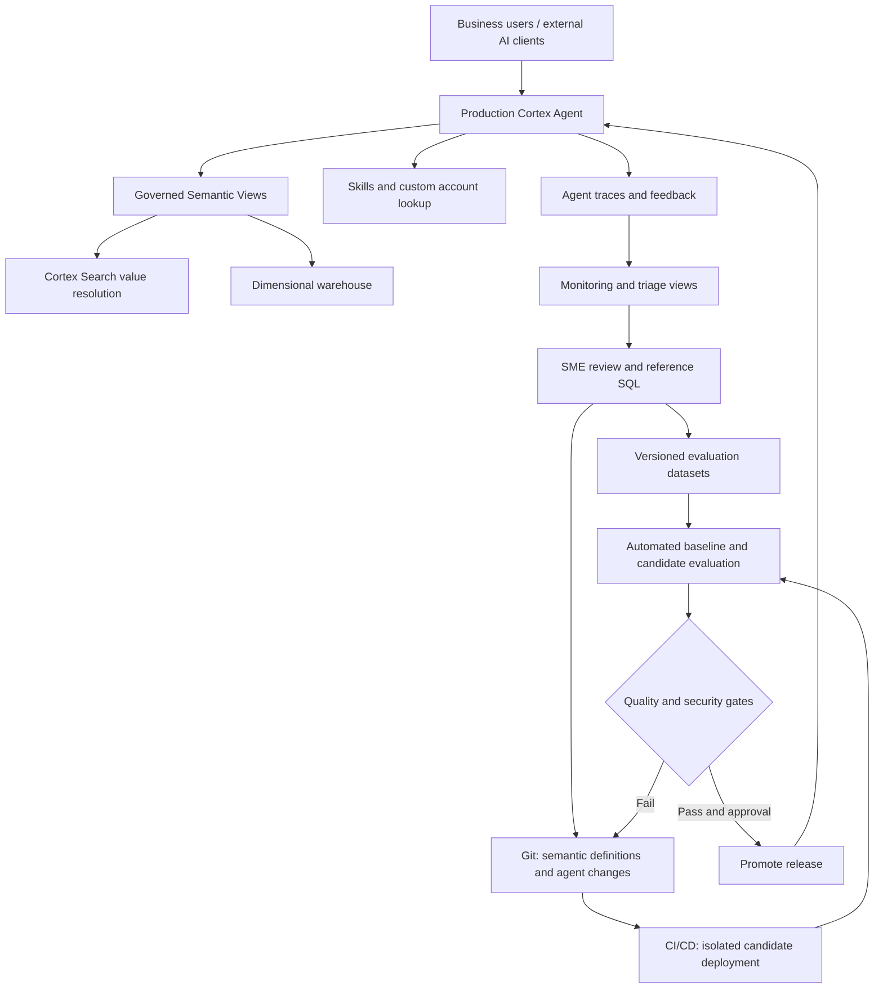
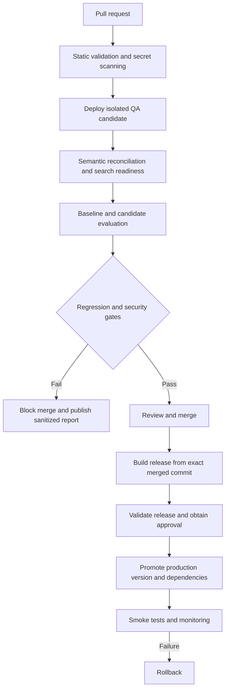

# From Prototype to Production

[Project Overview](../README.md) · [Data Model](../data/README.md) · [Semantic Views](../semantic_views/README.md) · [Cortex Agent](../agent/README.md) · [Evaluation](../evaluation/README.md) · [MCP Integration](../mcp/README.md) · [Demo](../demo/README.md)

---


Two approaches to operating an AI analytics solution, depending on team size, business requirements, and operational complexity:

- [Minimum Viable Production](production/minimum-viable-production.md) — a lightweight, practical approach for small data teams or a single Analytics Engineer.
- **Comprehensive Production Roadmap (described below)** — an extended architecture with automated CI/CD, observability, regression testing, and deployment quality gates.

## Overview

The existing project demonstrates a Snowflake-native business analytics agent built on governed Semantic Views, Cortex Analyst, Cortex Agent, domain-specific skills, custom account lookup, Cortex Search, and a managed MCP server.

Moving this architecture into production requires more than deploying the agent. The system must provide reliable metrics, controlled access, measurable answer quality, repeatable releases, and a mechanism for learning from actual business questions.

**Implementation status:** This document describes a proposed production architecture. The monitoring objects, automated evaluation scripts, CI/CD workflows, quality thresholds, and deployment procedures below are illustrative designs, not implemented or validated components of the current demonstration. The existing dimensional warehouse is assumed to be maintained separately.

## 1. Target production architecture



The production lifecycle separates runtime access, monitoring, business validation, and deployment. User traffic provides evidence for improvement but never directly modifies production definitions or approved test cases.

## 2. Environment and release isolation

| Environment | Purpose |
| --- | --- |
| Development | Author semantic definitions, skills, tool changes and tests |
| CI / QA | Deploy isolated candidate objects, reconcile metrics, evaluate and compare releases |
| Production | Serve approved versions through governed interfaces |

A release must include the agent specification, semantic view DDL, skills, account knowledge view and procedure, Cortex Search definitions, access grants, and relevant MCP configuration. Record the Git commit, object names, data snapshot or cutoff, search refresh status, dataset version, agent version, orchestration model and evaluation metric versions in a release manifest.

An immutable agent version does not freeze the objects it references. Replacing a shared Semantic View or skill file in place can change the behavior of an older agent version. Candidate objects should therefore be isolated by release schema or equivalent versioned naming; baseline and candidate should use the same controlled data snapshot and equivalent permissions. Search services must be ready before testing starts. Keep the previous dependency set available for rollback.

## 3. Agent observability and monitoring

Monitor the full question-to-answer path rather than just successful SQL execution. Capture the agent request, response, trace identifier, tool invocations, generated SQL, errors, verified-query usage, latency, feedback and release attribution where available. Correlate warehouse query history using observed query identifiers rather than assuming one SQL query per user question.

Suggested restricted operational objects in `DW.OBSERVABILITY`:

| Object | Grain / responsibility |
| --- | --- |
| `VW_AGENT_EVENTS` | One observability event or span |
| `VW_AGENT_TURNS` | One agent request trace with question, answer and execution indicators |
| `VW_QUESTION_TRIAGE` | One trace with review flags |
| `VW_QUESTION_PATTERNS` | Normalized question groups, frequency and repeat failures |
| `VW_AGENT_QUALITY_DAILY` | Daily operational metrics by release and domain |
| `EVAL_CASES` | Reviewed test cases and approval metadata |
| `RELEASE_MANIFEST` | One record per deployed release |
| `EVAL_RUNS` / `EVAL_RESULTS` | Run metadata and per-case metric results |

### Example: discover event types and build a request-level view

```sql
CREATE SCHEMA IF NOT EXISTS DW.OBSERVABILITY;

SELECT RECORD:name::STRING AS span_name, COUNT(*) AS event_count
FROM TABLE(SNOWFLAKE.LOCAL.GET_AI_OBSERVABILITY_EVENTS(
    'DW', 'SERVICE', 'BUSINESS_ANALYTICS_AGENT', 'CORTEX AGENT'
))
GROUP BY 1 ORDER BY 2 DESC;

CREATE OR REPLACE VIEW DW.OBSERVABILITY.VW_AGENT_TURNS AS
WITH events AS (
    SELECT TRACE:trace_id::STRING AS trace_id,
           TIMESTAMP AS event_ts,
           RECORD:name::STRING AS span_name,
           RECORD_ATTRIBUTES AS attrs
    FROM TABLE(SNOWFLAKE.LOCAL.GET_AI_OBSERVABILITY_EVENTS(
        'DW', 'SERVICE', 'BUSINESS_ANALYTICS_AGENT', 'CORTEX AGENT'
    ))
    WHERE TRACE:trace_id IS NOT NULL
)
SELECT trace_id,
       MIN(event_ts) AS started_at,
       MAX(event_ts) AS last_event_at,
       MAX(IFF(span_name = 'AgentV2RequestResponseInfo',
           attrs:"ai.observability.record_root.input"::STRING, NULL)) AS question,
       MAX(IFF(span_name = 'AgentV2RequestResponseInfo',
           attrs:"ai.observability.record_root.output"::STRING, NULL)) AS answer,
       COUNT_IF(span_name = 'SystemExecuteSQLTool_system_execute_sql') AS sql_calls,
       BOOLOR_AGG(COALESCE(
           attrs:"snow.ai.observability.agent.tool.sql_execution.verified_query_used"::BOOLEAN,
           FALSE)) AS used_verified_query
FROM events
GROUP BY trace_id
HAVING COUNT_IF(span_name = 'AgentV2RequestResponseInfo') > 0;
```

The example uses event names observed in Snowflake's reference implementation. Inspect actual payloads and adapt extraction before deploying; span names and attribute paths are not a stable business data contract. If the table function cannot be exposed through a view under the intended privileges, use a restricted scheduled collector and build views over its persisted output. Exclude evaluation and synthetic traffic using explicit run attribution; do not assume all traces are production requests.

### Example: triage signals and question frequency

```sql
CREATE OR REPLACE VIEW DW.OBSERVABILITY.VW_QUESTION_TRIAGE AS
SELECT *,
       CASE
           WHEN question IS NULL OR answer IS NULL THEN 'MISSING_TRACE_TEXT'
           WHEN answer ILIKE '%cannot answer%'
             OR answer ILIKE '%not available%' THEN 'REVIEW_SCOPE_OR_DATA'
           WHEN sql_calls = 0 THEN 'REVIEW_NO_SQL'
           WHEN answer ILIKE '%assuming%' THEN 'REVIEW_ASSUMPTION'
           ELSE 'SAMPLE_FOR_REVIEW'
       END AS review_bucket
FROM DW.OBSERVABILITY.VW_AGENT_TURNS;

SELECT LOWER(TRIM(question)) AS normalized_question,
       COUNT(*) AS question_count,
       MAX(started_at) AS last_seen
FROM DW.OBSERVABILITY.VW_QUESTION_TRIAGE
WHERE started_at >= DATEADD(day, -7, SYSDATE())
  AND question IS NOT NULL
GROUP BY 1
ORDER BY question_count DESC;
```

These are review signals, not failure labels. A conceptual question can correctly require no SQL, a refusal may be appropriate, and a confident answer can still be wrong. Supplement exact normalization with reviewed intent clustering, feedback, repeated or reformulated questions, tool errors and random sampling of apparently successful turns. Reconstruct follow-up questions using authorized conversation context before making standalone evaluation cases.

Operational monitoring should include request volume, error and timeout rate, p50/p95 latency, tool usage, negative feedback, search freshness, and warehouse/AI consumption. Use scheduled collection (Snowflake Tasks or an existing orchestrator), alert on sustained deviations, and retain telemetry only as long as necessary. Store raw questions, responses, SQL and account names in restricted Snowflake objects, not public GitHub artifacts.

## 4. Continuous improvement: from user questions to evaluation datasets

A weekly review cycle should identify business terminology gaps, incorrect metric selection, ambiguous account resolution, missing dimensions, unsupported questions and failures in cross-domain reasoning.

| Observed issue | Likely remediation |
| --- | --- |
| Wrong ARR type or reporting period | Metric descriptions, verified queries, financial skill |
| Monthly ARR snapshots summed | Semantic aggregation constraints and regression test |
| District student counts summed into state reach | Correct pre-aggregated measure and usage skill |
| Approximate account name fails | Cortex Search source, freshness, synonyms or disambiguation guidance |
| District incorrectly classified as paying customer | Account lookup and separate Preliminary ARR evidence |
| Correct individual KPIs but inconsistent executive summary | Agent orchestration and cross-domain test |
| Valid question requires unavailable data | Scope guidance or planned semantic model extension |

The review process is:

1. Select high-impact, frequent, failed and representative successful questions from monitoring views.
2. Remove sensitive information, deduplicate, and turn context-dependent questions into reproducible test inputs.
3. Optionally use an LLM to draft intent labels and expected behavior; treat all draft ground truth as untrusted until approved.
4. Validate expected numeric answers using independent reference SQL against controlled warehouse data, not the agent's own answer. Have a business subject matter expert approve definitions and interpretation.
5. Record expected tools, acceptable alternative behavior, required reporting grain, date range and numeric tolerances.
6. Add approved cases to a new immutable dataset version. Preserve earlier test cases unless a documented business definition change requires revision.
7. Evaluate the currently released baseline and candidate on that same dataset; only then promote changes.

### Dataset design

Maintain three suites: a stable regression suite (including the existing 15 questions), a growing traffic-derived suite, and a separately maintained holdout suite that is not copied into verified queries or agent instructions. Include security, missing-data and ambiguity cases. Track business-critical cases individually rather than relying on an average score.

```sql
CREATE TABLE IF NOT EXISTS DW.OBSERVABILITY.EVAL_CASES (
    case_id VARCHAR NOT NULL,
    dataset_version VARCHAR NOT NULL,
    suite VARCHAR NOT NULL,
    domain VARCHAR,
    input_query VARCHAR NOT NULL,
    ground_truth VARIANT,
    reference_sql VARCHAR,
    source_trace_id VARCHAR,
    critical BOOLEAN DEFAULT FALSE,
    review_status VARCHAR DEFAULT 'DRAFT',
    reviewed_by VARCHAR,
    reviewed_at TIMESTAMP_LTZ
);
```

Example of an approved case structure (approval itself is not simulated here):

```sql
INSERT INTO DW.OBSERVABILITY.EVAL_CASES
    (case_id, dataset_version, suite, domain, input_query,
     ground_truth, critical, review_status)
SELECT 'ARR-001', 'V002', 'REGRESSION', 'ARR',
       'Why should monthly ARR balances not be added to calculate annual ARR?',
       PARSE_JSON($${
         "ground_truth_output": "ARR is a point-in-time balance. Annual reporting uses the appropriate fiscal year-end snapshot, not the sum of monthly balances. Bookings represent period activity and can be summed across months.",
         "ground_truth_invocations": []
       }$$), TRUE, 'DRAFT';
```

The empty tool list assumes a conceptual question can be answered without tool calls; verify that this is the desired behavior for the configured agent before approving. If multiple routes are valid, avoid treating a single arbitrary tool path as mandatory; use outcome checks or a custom rubric. For data questions, populate `ground_truth_invocations` with exact registered tool names and expected input/output descriptions. Cortex Search invoked internally during Analyst value resolution is not necessarily a separate agent-level tool invocation; validate it through the appropriate traces and result correctness instead.

### Example: reference SQL for fiscal year-end ARR

```sql
SELECT SUM(ARR_AMOUNT) AS preliminary_arr
FROM DW.REVENUE.VW_FACT_ARR
WHERE ARR_TYPE = 'Preliminary'
  AND MON_LASTDAY = '2026-06-30'::DATE;
```

Confirm actual ARR type literals, physical grain, filters and amount precision against the repository DDL and business rules before using this query as ground truth. Missing snapshots must be handled explicitly. Never publish live financial values or account names in the public test fixtures.

## 5. Automated evaluation outside Snowsight

Snowflake supports native batch evaluation via SQL. Python or Snowflake CLI can orchestrate the process without requiring manual UI interaction.

### 5.1 Register an immutable evaluation dataset

```sql
USE SCHEMA DW.OBSERVABILITY;

CREATE TABLE EVAL_INPUT_V002 AS
SELECT INPUT_QUERY, GROUND_TRUTH
FROM DW.OBSERVABILITY.EVAL_CASES
WHERE DATASET_VERSION = 'V002'
  AND REVIEW_STATUS = 'APPROVED'
  AND SUITE IN ('REGRESSION', 'TRAFFIC');

CALL SYSTEM$CREATE_EVALUATION_DATASET(
    'Cortex Agent',
    'DW.OBSERVABILITY.EVAL_INPUT_V002',
    'DW.OBSERVABILITY.EVAL_DATASET_V002',
    OBJECT_CONSTRUCT('query_text', 'INPUT_QUERY',
                     'expected_tools', 'GROUND_TRUTH')
);
```

Before registration, verify nonempty input, unique questions, valid ground truth, coverage and case approval. Create a new version rather than overwriting a dataset used in earlier releases. Keep holdout inputs separately controlled.

### 5.2 Prepare the configuration stage

```sql
USE SCHEMA DW.OBSERVABILITY;
CREATE FILE FORMAT IF NOT EXISTS EVAL_YAML_FORMAT
    TYPE = CSV FIELD_DELIMITER = NONE
    RECORD_DELIMITER = '\n' ESCAPE_UNENCLOSED_FIELD = NONE;
CREATE STAGE IF NOT EXISTS EVAL_CONFIG
    FILE_FORMAT = EVAL_YAML_FORMAT;
```

Example `eval_baseline.yaml` (render actual version and object names from the release manifest):

```yaml
evaluation:
  agent_params:
    agent_name: "DW.SERVICE.BUSINESS_ANALYTICS_AGENT"
    agent_type: "CORTEX AGENT"
    agent_version: "VERSION$1"
  run_params:
    label: "Baseline V002"
  source_metadata:
    type: "dataset"
    dataset_name: "DW.OBSERVABILITY.EVAL_DATASET_V002"
metrics:
  - name: answer_correctness
    version: v3_0
  - name: logical_consistency
    version: v3_0
  - name: tool_selection_accuracy
    version: v3_0
  - name: tool_execution_accuracy
    version: v3_0
```

The candidate config changes the agent name/version and label as required by the isolated deployment. Dataset and metric versions remain identical. Tool metrics are preview capabilities; verify availability, privileges and supported judge models in the target account. Validate dataset name resolution in the session schema. Omit the YAML `dataset` creation block when reusing a registered dataset.

### 5.3 Start, poll and retrieve results

Run `PUT` from Snowflake CLI or a supported connector with access to the local files, not a worksheet:

```sql
PUT file://eval_baseline.yaml @DW.OBSERVABILITY.EVAL_CONFIG/release_002/
    AUTO_COMPRESS = FALSE OVERWRITE = TRUE;
PUT file://eval_candidate.yaml @DW.OBSERVABILITY.EVAL_CONFIG/release_002/
    AUTO_COMPRESS = FALSE OVERWRITE = TRUE;

USE SCHEMA DW.OBSERVABILITY;
CALL EXECUTE_AI_EVALUATION('START',
    OBJECT_CONSTRUCT('run_name', 'baseline_r002_v002'),
    '@DW.OBSERVABILITY.EVAL_CONFIG/release_002/eval_baseline.yaml');
CALL EXECUTE_AI_EVALUATION('STATUS',
    OBJECT_CONSTRUCT('run_name', 'baseline_r002_v002'),
    '@DW.OBSERVABILITY.EVAL_CONFIG/release_002/eval_baseline.yaml');
```

Repeat for the candidate with its own run name and config. A production script should use unique run IDs, bounded polling, retries for transient errors, and fail closed on timeouts, cancellation, incomplete or failed runs. Only completed runs with validated coverage are eligible for comparison.

```sql
SELECT INPUT, METRIC_NAME, EVAL_AGG_SCORE,
       METRIC_CALLS[0]:explanation::STRING AS explanation
FROM TABLE(SNOWFLAKE.LOCAL.GET_AI_EVALUATION_DATA(
    'DW', 'SERVICE', 'BUSINESS_ANALYTICS_AGENT',
    'CORTEX AGENT', 'baseline_r002_v002'
));
```

Persist the results with release ID, case ID, dataset version, run ID and metric version. Use the actual candidate database, schema and agent name when retrieving candidate results. Keep sensitive answers and explanations in Snowflake.

## 6. Regression comparison and quality gates

An automated evaluation must distinguish correctness of the warehouse and semantic metrics from quality of the generated agent answer. LLM judging complements, but does not replace, deterministic reconciliation and security checks.

Example comparison over persisted results (the proposed `EVAL_RESULTS` contract includes `RUN_ID`, `CASE_ID`, `METRIC_NAME`, `SCORE`):

```sql
WITH b AS (
    SELECT case_id, metric_name, score
    FROM DW.OBSERVABILITY.EVAL_RESULTS
    WHERE run_id = 'baseline_r002_v002'
), c AS (
    SELECT case_id, metric_name, score
    FROM DW.OBSERVABILITY.EVAL_RESULTS
    WHERE run_id = 'candidate_r002_v002'
)
SELECT COALESCE(b.case_id, c.case_id) AS case_id,
       COALESCE(b.metric_name, c.metric_name) AS metric_name,
       b.score AS baseline_score,
       c.score AS candidate_score,
       c.score - b.score AS delta,
       CASE WHEN b.score IS NULL OR c.score IS NULL THEN 'MISSING'
            WHEN c.score < b.score THEN 'REGRESSION'
            ELSE 'NO_REGRESSION' END AS result
FROM b FULL OUTER JOIN c
  ON b.case_id = c.case_id AND b.metric_name = c.metric_name;
```

Validate uniqueness and compare against the expected case-by-metric matrix as well; a full join alone cannot detect a case absent from both runs.

Illustrative release policy (not measured project results):

| Gate | Proposed policy |
| --- | --- |
| Semantic reconciliation | All deterministic checks pass within approved numeric tolerances |
| Dataset completeness | All expected applicable case/metric results present; no duplicate or null scores |
| Answer correctness | Mean >= 0.90 and no drop greater than 0.02 from baseline |
| Logical consistency | Mean >= 0.90 |
| Tool selection / execution | Mean >= 0.90 where applicable and ground truth is approved |
| Critical cases | No critical financial, privacy or aggregation failure |
| Security and MCP smoke tests | All required checks pass |
| Performance and cost | Within agreed service budgets |

These initial thresholds require calibration on repeated baseline runs. Agent behavior is nondeterministic even with pinned configuration. Compare repeated runs, inspect individual failures and score distributions, and document any approved exceptions. A missing score is not a pass. Test search ambiguity, unsupported questions, data absence and unauthorized access with explicit assertions rather than relying solely on an LLM judge.

## 7. CI/CD design

Git is the source of truth for semantic definitions, agent instructions, skills, search configuration and deployment scripts. Sensitive evaluation data stays in Snowflake. GitHub Actions orchestrates changes without granting pull requests access to production credentials.



Proposed script layout (not existing repository files):

```text
production/
  README.md
  sql/
    01_monitoring_views.sql
    02_evaluation_catalog.sql
    03_register_dataset.sql
    04_evaluation_stage.sql
    05_compare_runs.sql
    06_security_tests.sql
    07_promote_release.sql
    08_rollback_release.sql
  config/
    eval_config.template.yaml
    quality_gates.yaml
  scripts/
    deploy_candidate.py
    run_evaluation.py
    compare_runs.py
    smoke_test.py
    promote_release.py
.github/workflows/
  validate-pr.yml
  release.yml
```

### Example workflow blueprint

The following YAML is an orchestration skeleton. Referenced scripts, authentication setup and dependencies would need implementation; it is not a ready-to-run workflow.

```yaml
name: Semantic agent regression
on:
  pull_request:
    branches: [main]
  workflow_dispatch:
permissions:
  contents: read
jobs:
  static-checks:
    runs-on: ubuntu-latest
    steps:
      - uses: actions/checkout@v4
      - run: python -m compileall production/scripts
      # Add SQL/YAML linting, link and secret scanning.
  evaluate:
    needs: static-checks
    if: github.event_name == 'workflow_dispatch' || github.event.pull_request.head.repo.full_name == github.repository
    runs-on: ubuntu-latest
    environment: snowflake-qa
    permissions:
      contents: read
      id-token: write
    steps:
      - uses: actions/checkout@v4
      - uses: actions/setup-python@v5
        with:
          python-version: '3.12'
      - run: pip install -r production/requirements.txt
      # Configure Snowflake workload identity federation for this environment.
      - run: python production/scripts/deploy_candidate.py
      - run: python production/scripts/run_evaluation.py --target both
      - run: python production/scripts/compare_runs.py --fail-on-regression
      - run: python production/scripts/smoke_test.py --environment qa
      - uses: actions/upload-artifact@v4
        if: always()
        with:
          name: sanitized-evaluation-report
          path: production/reports/sanitized/
```

Use protected QA and production environments with required reviewers, branch protection and a trusted execution policy. Forked or otherwise untrusted code must not obtain Snowflake credentials. Require an authorized QA evaluation for the exact release commit even when the PR evaluation is skipped. Prefer short-lived workload identity federation where supported, or another approved noninteractive authentication method. Pin action dependencies to reviewed commit SHAs in the actual implementation. Use distinct deployment, evaluation and runtime roles.

The orchestration script should implement the following contract:

```python
# Pseudocode: proposed orchestration, not executable as-is.
def evaluate_release(manifest):
    validate_dataset(manifest.dataset)
    verify_dependency_readiness(manifest)
    for target in (manifest.baseline, manifest.candidate):
        config = render_config(target, manifest.dataset, manifest.metrics)
        path = upload_config(config, manifest.release_id, target)
        run_id = start_evaluation(path)
        wait_for_success(run_id, path, timeout_seconds=3600)
        persist_results(run_id, target, manifest)
    assert_complete_case_metric_matrix(manifest)
    assert_quality_gates(manifest)
    write_sanitized_report(manifest)
```

Return a nonzero process exit code on any failed gate. Publish aggregate metrics and sanitized case identifiers only. Serialize production deployments and ensure approval applies to the exact tested release manifest; do not promote an untested version built after the gate.

## 8. Production promotion and rollback

For agent-only changes, Snowflake named agent versions and aliases can support controlled promotion. For example, after resolving the actual approved version from the release manifest:

```sql
-- Example only: VERSION$2 must be the approved version.
ALTER AGENT DW.SERVICE.BUSINESS_ANALYTICS_AGENT
    MODIFY VERSION VERSION$2 SET ALIAS = production;
ALTER AGENT DW.SERVICE.BUSINESS_ANALYTICS_AGENT
    SET DEFAULT_VERSION = 'VERSION$2';
```

Confirm the supported versioning syntax and that the MCP endpoint invokes the intended production/default version. For full-stack changes, promote the complete validated dependency set, not just the agent alias. If separate agent objects are used, the controlled routing change must also be validated. Avoid destructive replacement of the active dependency set.

After deployment, execute smoke tests for ARR, bookings, product usage, ambiguous account names and cross-domain KPIs using the runtime role, including the external MCP path. Record release time, operator, previous release and gate results. Rollback restores the previous agent routing and all compatible dependencies, followed by the same smoke tests. Retain previous releases for an agreed period.

## 9. Security, governance and operational controls

- Separate runtime, monitoring, evaluation, deployment and production approval responsibilities using least privilege.
- Validate access through Semantic Views, the owner-rights account lookup procedure, Cortex Search and MCP independently. Cortex Search can expose indexed values under owner-rights behavior even when a caller cannot read the underlying table; restrict service access and index only approved fields or segregate services by security boundary.
- Test row-level and column-level restrictions with representative restricted roles. Do not assume semantic definitions alone enforce authorization.
- Restrict unredacted observability data and evaluation ground truth. Apply retention, audit and redaction policies before collecting real user questions.
- Maintain an allowlisted tool surface, read-only analytics access, credential rotation/revocation procedures and prompt-injection tests. Validate that the agent cannot bypass business access boundaries through custom tools.
- Monitor warehouse and AI consumption, evaluation cost and search refresh cost. Set budgets and appropriate alerts; warehouse resource monitors alone do not cover all AI or serverless charges.
- Treat native Cortex Agent evaluation as one layer. Separately test Cortex Analyst SQL generation, deterministic metric reconciliation, external MCP authentication and client-visible behavior. The native evaluation does not substitute for end-to-end external client testing.

## 10. Proposed implementation roadmap

| Phase | Deliverables | Exit criteria |
| --- | --- | --- |
| 1. Operational foundation | Restricted roles, release manifest, observability collector and views | Reliable telemetry, access controls and release attribution |
| 2. Evaluation foundation | Corrected tool ground truth, approved case catalog, immutable datasets | Reproducible baseline and business-approved expectations |
| 3. Continuous improvement | Scheduled question triage, SME review, traffic-derived tests | Reviewed new cases and traceable remediation |
| 4. CI/CD | Isolated deployment, SQL/Python evaluation, comparison and quality gate | Regressions block release; sanitized results available |
| 5. Production rollout | Protected promotion, MCP smoke tests, alerts and rollback | Approved release with tested recovery procedure |

## Conclusion

The production objective is to evolve a demonstrated analytics agent into a governed business service with a measurable quality lifecycle. Real questions reveal gaps; reviewed evidence becomes regression tests; version-controlled improvements are evaluated against a stable baseline; only validated releases reach users.

This design preserves the Semantic Views as the source of governed metric definitions while keeping business knowledge, AI orchestration, observability and release management as distinct responsibilities.

## References

- [Cortex Agent evaluations](https://docs.snowflake.com/en/user-guide/snowflake-cortex/cortex-agents-evaluations)
- [EXECUTE_AI_EVALUATION](https://docs.snowflake.com/en/sql-reference/functions/execute_ai_evaluation)
- [Refine a semantic view from agent logs](https://docs.snowflake.com/en/developer-guide/cortex-ai-cookbook/refinement-loop-from-agent-logs)
- [Turn agent feedback into evaluation datasets](https://docs.snowflake.com/en/developer-guide/cortex-ai-cookbook/agent-feedback-to-evals)
- [Evaluate and promote Cortex Agent versions](https://docs.snowflake.com/en/developer-guide/cortex-ai-cookbook/agent-evaluations)
- [Agent versioning and promotion](https://docs.snowflake.com/en/developer-guide/cortex-ai-cookbook/agent-versioning-and-promotion)
- [Agent CI/CD reference architecture](https://docs.snowflake.com/en/developer-guide/cortex-ai-cookbook/agent-ci-cd-with-dbt)
- [Cortex Analyst evaluations](https://docs.snowflake.com/en/user-guide/snowflake-cortex/cortex-analyst-evaluations)
- [Cortex Search overview](https://docs.snowflake.com/en/user-guide/snowflake-cortex/cortex-search/cortex-search-overview)

---

[Back to Project Overview](../README.md)
