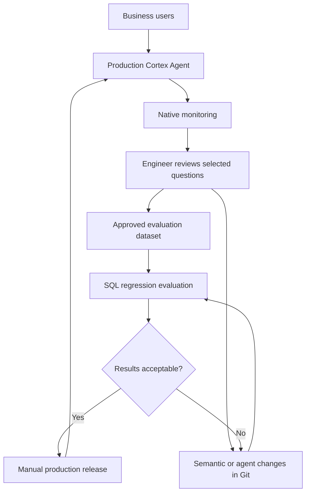

# Minimum Viable Production

[Project Overview](../README.md) · [Semantic Views](../semantic_views/README.md) · [Cortex Agent](../agent/README.md) · [Evaluation](../evaluation/README.md) · [Full Production Roadmap](README.md)

## Overview

A production AI analytics solution should reduce the workload of a data team, not become another platform that requires a dedicated team to operate. For a small company with one Analytics Engineer or a small data team, the comprehensive architecture described in the [Production Roadmap](README.md) may be disproportionate to the actual business value and adoption of the agent.

This document proposes a lightweight alternative: reuse the existing dimensional warehouse, data quality checks, Git repository and Snowflake-native monitoring and evaluation capabilities. Automate repeatable SQL checks, but keep business review and production deployment under human control.

**Implementation status:** Proposed operating model. The SQL and YAML below are illustrative templates, not deployed or tested components of the demonstration. Object names, permissions, agent versions and metric settings must be confirmed in the target account.

## 1. Minimum operating model

| Activity | Minimum implementation | When |
| --- | --- | --- |
| Data quality | Existing warehouse tests and semantic reconciliation | Existing data pipeline cadence; before semantic releases |
| Monitoring | Native Cortex Agent monitoring and a reusable question-review query | Weekly initially, or when an issue is reported |
| Evaluation dataset | One maintained, versioned collection of approved business questions | When new scenarios or failures are identified |
| Regression testing | Native SQL evaluation and baseline/candidate comparison | Before changes affecting agent behavior |
| Deployment | Manual release from Git with explicit approval | After successful validation |
| Rollback | Previous agent version and dependency definitions | When a release introduces a material regression |
| Access and cost | Existing Snowflake roles, restricted telemetry and usage review | Initially and whenever access or usage changes |

No new orchestration platform, custom monitoring dashboard, dedicated evaluation service or automatic production promotion is required. A single restricted evaluation schema and an existing Snowflake warehouse are sufficient to start, subject to account feature availability.



## 2. Review actual user questions

Start with the built-in Cortex Agent monitoring interface. Investigate reported incorrect answers, common questions, repeated reformulations and a small sample of apparently successful responses. There is no need to persist every trace in another monitoring database.

A reusable SQL query can make this review easier. The following example extracts a request-level summary from the native observability events. Replace `BUSINESS_ANALYTICS_AGENT` with the deployed agent name. Use a restricted role authorized to view the relevant telemetry.

### `01_review_questions.sql`

```sql
WITH events AS (
    SELECT TRACE:trace_id::STRING AS trace_id,
           TIMESTAMP AS event_ts,
           RECORD:name::STRING AS span_name,
           RECORD_ATTRIBUTES AS attrs
    FROM TABLE(SNOWFLAKE.LOCAL.GET_AI_OBSERVABILITY_EVENTS(
        'DW', 'SERVICE', 'BUSINESS_ANALYTICS_AGENT', 'CORTEX AGENT'
    ))
    WHERE TIMESTAMP >= DATEADD(day, -7, CURRENT_TIMESTAMP())
      AND TRACE:trace_id IS NOT NULL
)
SELECT trace_id,
       MIN(event_ts) AS requested_at,
       MAX(IFF(span_name = 'AgentV2RequestResponseInfo',
           attrs:"ai.observability.record_root.input"::STRING,
           NULL)) AS question,
       MAX(IFF(span_name = 'AgentV2RequestResponseInfo',
           attrs:"ai.observability.record_root.output"::STRING,
           NULL)) AS answer
FROM events
GROUP BY trace_id
HAVING COUNT_IF(span_name = 'AgentV2RequestResponseInfo') > 0
ORDER BY requested_at DESC;
```

Run this query on demand, or expose it as a restricted view if the target account supports that usage. Inspect actual event attributes first; inputs may contain structured conversation payloads rather than plain question text. Adjust extraction and date boundaries accordingly. Exclude evaluation runs and other synthetic requests when reviewing business traffic. Redacted telemetry may require additional privileges to retrieve full text; do not grant those privileges to ordinary agent consumers.

Use native traces and query history for individual investigations. Check adoption and consumption through Snowflake usage history; a separate telemetry pipeline is unnecessary at this stage.

### What to do with the findings

| Observed behavior | Action |
| --- | --- |
| Incorrect fiscal period or ARR type | Clarify semantic descriptions, verified queries or financial instructions |
| Monthly ARR snapshots added together | Check non-additive time rules and add a regression case |
| Distinct student counts aggregated incorrectly | Check usage grain, product overlap and aggregation instructions |
| Account name not resolved correctly | Review Cortex Search freshness, indexed attributes and disambiguation |
| District classified incorrectly as a paying customer | Review account lookup and separate ARR-based classification |
| Unsupported question | Clarify supported scope or consider adding a new business capability |
| Correct SQL but incorrect narrative | Review agent instructions and add an answer-level evaluation |

Do not treat every unusual answer as a defect. A clarification request or a statement that data is unavailable can be correct. A successful SQL statement is also not proof of a correct business answer.

## 3. Expand the evaluation dataset incrementally

Reuse the existing evaluation questions described in the [Evaluation README](../evaluation/README.md). Add a new case when it represents a new business scenario, an important failure or a recurring ambiguity. There is no need to turn every user question into a test.

For each selected question:

1. Rewrite it as a standalone question with explicit dates and necessary context.
2. Remove or protect sensitive information.
3. Verify the expected answer independently against trusted business definitions and reference SQL. Ask the appropriate business owner to confirm ambiguous definitions.
4. Record the expected behavior and whether it is business-critical. Include expected tool invocations only when tool routing is explicitly being tested and the expected route is known.
5. Add the approved case to the next dataset version while retaining previous valid cases.

For example, a real question about annual ARR may reveal that the user expects a sum of monthly balances. A regression case should verify the correct reporting rule, not simply reproduce the agent's original response. For numerical cases, use a fixed period and refresh the expected result if legitimate source corrections change it. Keep baseline and candidate data comparable.

### `02_create_dataset.sql`

Maintain one source table containing approved cases. Seed it with the existing evaluation questions. The `CRITICAL` flag is used for manual release review; Snowflake's native dataset only needs the input and ground truth mapping.

```sql
CREATE SCHEMA IF NOT EXISTS DW.EVALUATION;

CREATE TABLE IF NOT EXISTS DW.EVALUATION.APPROVED_CASES (
    CASE_ID VARCHAR NOT NULL,
    INPUT_QUERY VARCHAR NOT NULL,
    GROUND_TRUTH VARIANT NOT NULL,
    CRITICAL BOOLEAN DEFAULT FALSE
);

-- Example: add only after business validation.
MERGE INTO DW.EVALUATION.APPROVED_CASES t
USING (
    SELECT 'ARR-ANNUAL-01' AS case_id,
           'Why should monthly ARR not be summed for annual reporting?' AS input_query,
           OBJECT_CONSTRUCT('ground_truth_output',
               'ARR is a point-in-time balance. Use the appropriate fiscal year-end snapshot, rather than summing monthly balances. Bookings represent period activity and can be summed across months.') AS ground_truth,
           TRUE AS critical
) s ON t.case_id = s.case_id
WHEN NOT MATCHED THEN INSERT (case_id, input_query, ground_truth, critical)
VALUES (s.case_id, s.input_query, s.ground_truth, s.critical);

-- Review these checks before registering a new dataset.
SELECT COUNT(*) AS cases, COUNT(DISTINCT case_id) AS unique_ids,
       COUNT(DISTINCT input_query) AS unique_questions,
       COUNT_IF(ground_truth:ground_truth_output IS NULL) AS missing_answers
FROM DW.EVALUATION.APPROVED_CASES;

-- Use a new version name for each approved revision.
-- Do not overwrite the dataset used by a previous release.
CREATE TABLE DW.EVALUATION.EVAL_INPUT_V002 AS
SELECT case_id, input_query, ground_truth, critical
FROM DW.EVALUATION.APPROVED_CASES;

CALL SYSTEM$CREATE_EVALUATION_DATASET(
    'Cortex Agent',
    'DW.EVALUATION.EVAL_INPUT_V002',
    'DW.EVALUATION.EVAL_DATASET_V002',
    OBJECT_CONSTRUCT('query_text', 'INPUT_QUERY',
                     'expected_tools', 'GROUND_TRUTH')
);
```

Check that the approved suite is nonempty, IDs and questions are unique, and expected answers are valid before creating the snapshot. The example is an incremental addition, not a replacement for the existing evaluation dataset. Keep real questions, account names, financial values and traces in restricted company storage, not a public repository.

## 4. Evaluate before releasing a change

The engineer can run native evaluations directly from SQL without opening the evaluation UI. There is no need for a Python application or a CI/CD pipeline to start with.

Use the same dataset and scoring configuration for the current baseline and the proposed candidate. For a small team, start with answer correctness and logical consistency. Add tool selection and execution metrics later if the expected invocation data is maintained correctly.

### 4.1 Prepare two configuration files

One-time setup:

```sql
CREATE FILE FORMAT IF NOT EXISTS DW.EVALUATION.YAML_FORMAT
    TYPE = CSV FIELD_DELIMITER = NONE
    RECORD_DELIMITER = '\n' ESCAPE_UNENCLOSED_FIELD = NONE;
CREATE STAGE IF NOT EXISTS DW.EVALUATION.EVAL_CONFIG
    FILE_FORMAT = DW.EVALUATION.YAML_FORMAT;
```

Example `eval_baseline.yaml`:

```yaml
evaluation:
  agent_params:
    agent_name: "DW.SERVICE.BUSINESS_ANALYTICS_AGENT"
    agent_type: "CORTEX AGENT"
    agent_version: "VERSION$1"
  run_params:
    label: "Release 002 baseline"
  source_metadata:
    type: "dataset"
    dataset_name: "DW.EVALUATION.EVAL_DATASET_V002"
metrics:
  - name: answer_correctness
    version: v3_0
  - name: logical_consistency
    version: v3_0
```

Create `eval_candidate.yaml` with the actual candidate agent name/version and a different label. Confirm version identifiers and supported metric versions in the account. Upload both files using Snowflake CLI or a supported client (local `PUT` is not a worksheet operation):

```sql
PUT file://eval_baseline.yaml @DW.EVALUATION.EVAL_CONFIG/r002/
    AUTO_COMPRESS = FALSE OVERWRITE = TRUE;
PUT file://eval_candidate.yaml @DW.EVALUATION.EVAL_CONFIG/r002/
    AUTO_COMPRESS = FALSE OVERWRITE = TRUE;
```

### 4.2 Keep the candidate separate from production

For agent-instruction-only changes, saved agent versions can be sufficient if their dependencies remain unchanged. For Semantic View, skill, stored procedure or Cortex Search changes, use temporary candidate objects or an existing development schema. Point the candidate agent at those objects while leaving production dependencies intact. Verify search refresh status before testing.

An agent version does not freeze the definitions or data of referenced objects. If shared dependencies are overwritten first, a baseline-versus-candidate comparison can be misleading. If isolation is unavailable, capture baseline results before changing dependencies and test against a stable data cutoff; acknowledge that comparison is weaker and use a controlled maintenance window rather than experimenting on live users.

### `03_run_evaluation.sql`

```sql
USE SCHEMA DW.EVALUATION;

CALL EXECUTE_AI_EVALUATION('START',
    OBJECT_CONSTRUCT('run_name', 'r002_baseline'),
    '@DW.EVALUATION.EVAL_CONFIG/r002/eval_baseline.yaml');

CALL EXECUTE_AI_EVALUATION('START',
    OBJECT_CONSTRUCT('run_name', 'r002_candidate'),
    '@DW.EVALUATION.EVAL_CONFIG/r002/eval_candidate.yaml');
```

Use unique run names for each execution. Run the status statements separately until both runs report `COMPLETED`. Do not compare failed, cancelled or partial runs.

```sql
CALL EXECUTE_AI_EVALUATION('STATUS',
    OBJECT_CONSTRUCT('run_name', 'r002_baseline'),
    '@DW.EVALUATION.EVAL_CONFIG/r002/eval_baseline.yaml');

CALL EXECUTE_AI_EVALUATION('STATUS',
    OBJECT_CONSTRUCT('run_name', 'r002_candidate'),
    '@DW.EVALUATION.EVAL_CONFIG/r002/eval_candidate.yaml');
```

## 5. Compare results with one SQL script

There is no need to create a separate evaluation results warehouse. Query Snowflake's native results and review the differences directly. Use the actual candidate object identity if it is a separate agent.

### `04_compare_results.sql`

```sql
-- Run after confirming both evaluations are COMPLETED.
CREATE OR REPLACE TEMP TABLE RELEASE_COMPARISON AS
WITH expected AS (
    SELECT q.case_id, q.input_query, q.critical, m.metric_name
    FROM DW.EVALUATION.EVAL_INPUT_V002 q
    CROSS JOIN (SELECT column1 AS metric_name FROM VALUES
        ('answer_correctness'), ('logical_consistency')) m
), baseline AS (
    SELECT input, metric_name, COUNT(*) AS n,
           MAX(eval_agg_score) AS score, COUNT_IF(error IS NOT NULL) AS errors
    FROM TABLE(SNOWFLAKE.LOCAL.GET_AI_EVALUATION_DATA(
        'DW', 'SERVICE', 'BUSINESS_ANALYTICS_AGENT',
        'CORTEX AGENT', 'r002_baseline'))
    GROUP BY input, metric_name
), candidate AS (
    SELECT input, metric_name, COUNT(*) AS n,
           MAX(eval_agg_score) AS score, COUNT_IF(error IS NOT NULL) AS errors,
           MAX(metric_calls[0]:explanation::STRING) AS explanation
    FROM TABLE(SNOWFLAKE.LOCAL.GET_AI_EVALUATION_DATA(
        'DW', 'SERVICE', 'BUSINESS_ANALYTICS_AGENT',
        'CORTEX AGENT', 'r002_candidate'))
    GROUP BY input, metric_name
)
SELECT e.*, b.score AS baseline_score, c.score AS candidate_score,
       c.score - b.score AS delta, c.explanation,
       CASE WHEN COALESCE(b.n, 0) <> 1 OR COALESCE(c.n, 0) <> 1
              OR b.score IS NULL OR c.score IS NULL
              OR b.errors > 0 OR c.errors > 0 THEN 'INVALID_OR_MISSING'
            WHEN c.score < b.score THEN 'REVIEW_REGRESSION'
            WHEN c.score > b.score THEN 'IMPROVED'
            ELSE 'UNCHANGED' END AS result
FROM expected e
LEFT JOIN baseline b ON e.input_query = b.input AND e.metric_name = b.metric_name
LEFT JOIN candidate c ON e.input_query = c.input AND e.metric_name = c.metric_name;

-- Summary by metric; never hide invalid cases behind an average.
SELECT metric_name, COUNT(*) AS expected_cases,
       COUNT_IF(result = 'INVALID_OR_MISSING') AS invalid_cases,
       ROUND(AVG(baseline_score), 3) AS baseline_avg,
       ROUND(AVG(candidate_score), 3) AS candidate_avg,
       COUNT_IF(result = 'REVIEW_REGRESSION') AS regressions
FROM RELEASE_COMPARISON
GROUP BY metric_name;

-- Review every regression and every critical business case.
SELECT * FROM RELEASE_COMPARISON
WHERE result IN ('INVALID_OR_MISSING', 'REVIEW_REGRESSION') OR critical
ORDER BY critical DESC, delta ASC NULLS FIRST;
```

The comparison expects one result for each unique question and configured metric. Verify the returned run metadata and metric names, and check for unexpected extra inputs or metrics before relying on the report. Save the run IDs and a short review summary in the internal release record. Native evaluation is probabilistic: investigate score changes rather than treating every small difference as a definite defect.

## 6. Manual release decision

The release does not need an elaborate automated approval system. A simple checklist is enough for a low-risk internal analytics pilot:

- [ ] Existing data quality and semantic reconciliation tests pass.
- [ ] Both evaluation runs are complete, with no missing or invalid required scores.
- [ ] All business-critical questions have been reviewed against expected results.
- [ ] Material regressions are fixed, or explicitly accepted by the responsible business owner.
- [ ] New functionality has at least one approved test case.
- [ ] Changes to access, search indexing and owner-rights procedures have been tested with the intended consumer role.
- [ ] Previous agent version and dependency definitions are available for rollback.

Use human judgment rather than an arbitrary universal score threshold. For ARR or executive reporting, deterministic numerical reconciliation and business approval matter more than an average LLM judge score. Keep the agent advisory for high-stakes decisions; existing validated reporting remains the source for official numbers.

After approval, promote the tested agent version and matching dependency definitions using the existing release process. Run a small post-deployment smoke test covering bookings, ARR, product usage, account resolution and the external MCP connection (if used). Native agent evaluation does not replace an end-to-end test of ChatGPT and its connector.

If a material error is found, restore the previous tested agent and compatible dependencies from Git or retained objects. Do not assume reverting the agent version alone restores Semantic Views, skill files or Cortex Search behavior. If the rollback cannot be performed safely, temporarily restrict access until the issue is resolved.

Record only the essentials: Git commit, agent version, dataset version, baseline/candidate run IDs, release decision and known limitations. A short internal release note is sufficient.

## 7. Suggested repository structure

```text
production/
+-- README.md                       # Comprehensive production roadmap
+-- minimum-viable-production.md     # This lightweight alternative
+-- sql/                            # Optional future extraction of examples
    +-- 01_review_questions.sql
    +-- 02_create_dataset.sql
    +-- 03_run_evaluation.sql
    +-- 04_compare_results.sql
```

The SQL examples and YAML configuration can initially remain in this document. Extract them into reusable files only when they are actually used. No additional files or infrastructure are implied to exist in the current project.

## 8. When to invest in more automation

Consider the full [Production Roadmap](README.md) when manual reviews become a recurring bottleneck, releases become frequent, multiple engineers maintain the agent, usage or cost grows materially, or security and audit requirements demand stronger controls. At that point, the same SQL scripts can be incorporated into the existing deployment workflow or GitHub Actions, without redesigning the evaluation approach.

The minimum approach is intended for a limited, governed internal deployment. It is not a substitute for stronger isolation, access enforcement, monitoring or formal approval where business risk or regulation requires them.

**The objective is not to build an AI operations platform. It is to maintain a useful and trustworthy analytics capability at an operational cost proportional to its business value.**

## References

- [Monitor Cortex Agent requests](https://docs.snowflake.com/en/user-guide/snowflake-cortex/cortex-agents-monitor)
- [Refine semantic views from agent logs](https://docs.snowflake.com/en/developer-guide/cortex-ai-cookbook/refinement-loop-from-agent-logs)
- [Turn user feedback into evaluation datasets](https://docs.snowflake.com/en/developer-guide/cortex-ai-cookbook/agent-feedback-to-evals)
- [SYSTEM$CREATE_EVALUATION_DATASET](https://docs.snowflake.com/en/sql-reference/functions/system_create_evaluation_dataset)
- [EXECUTE_AI_EVALUATION](https://docs.snowflake.com/en/sql-reference/functions/execute_ai_evaluation)
- [GET_AI_EVALUATION_DATA](https://docs.snowflake.com/en/sql-reference/functions/get_ai_evaluation_data-snowflake-local)
- [Evaluate and promote Cortex Agent versions](https://docs.snowflake.com/en/developer-guide/cortex-ai-cookbook/agent-evaluations)

---

[Back to Production Roadmap](README.md) · [Back to Project Overview](../README.md)
