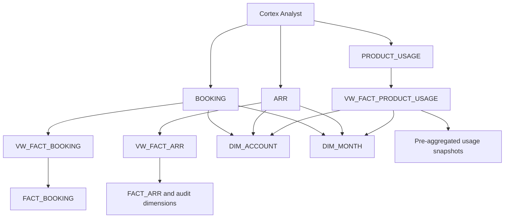
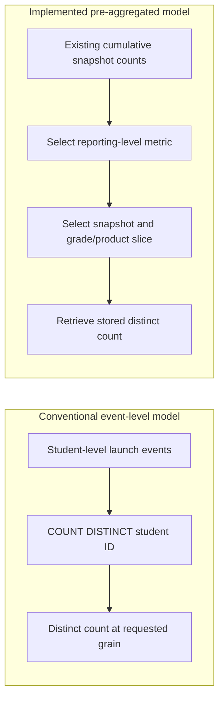
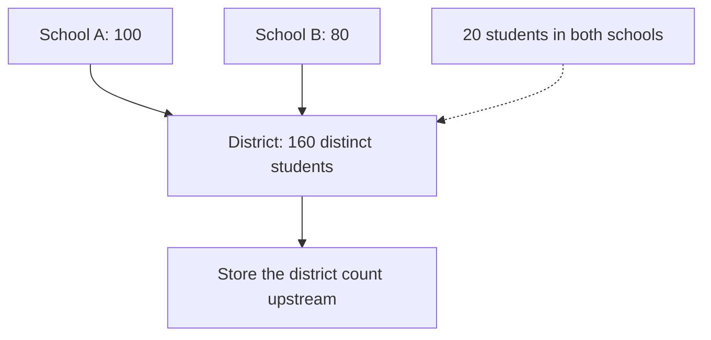
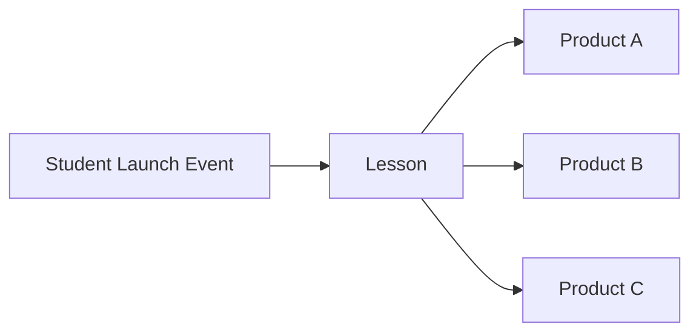
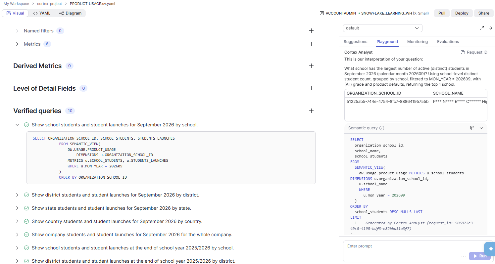
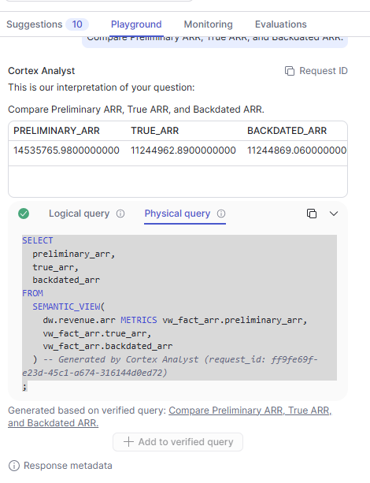
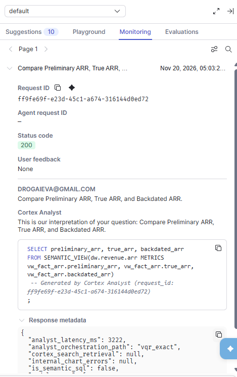

# Snowflake Semantic Views Business Metrics and Aggregation Semantics

[Project Overview](../README.md) · [Data Model](../data/README.md) · [Semantic Views](../semantic_views/README.md) · [Cortex Agent](../agent/README.md) · [Evaluation](../evaluation/README.md) · [MCP Integration](../mcp/README.md) · [Demo](../demo/README.md)

---

## Objective

The semantic layer defines how business metrics are calculated, which dimensions are meaningful, and how results should be aggregated. This implementation deliberately tests three different modeling scenarios rather than three variations of `SUM`:

- **Bookings:** a fully additive financial flow.
- **Annual Recurring Revenue (ARR):** a semi-additive balance with alternative business definitions.
- **Product Usage:** non-additive distinct counts that have already been calculated upstream at multiple reporting levels, alongside cumulative launch-event counts.

The project assumes an existing populated dimensional warehouse. Source data, event-level processing and warehouse population are outside its scope. In particular, the product usage model intentionally assumes that distinct counts are already materialized; the purpose is to test whether a semantic layer can correctly expose those counts without access to student-level records.

## 1. Semantic layer architecture



Booking and ARR declare relationships to account and month dimensions in their semantic definitions. Product Usage exposes a single logical table (`U`); its supporting SQL view already joins the monthly usage snapshots to calendar and account attributes.

| Semantic view | Metric behavior | Time basis | Verified queries |
| --- | --- | --- | ---: |
| `DW.REVENUE.BOOKING` | Fully additive | Activity within reporting period | 6 |
| `DW.REVENUE.ARR` | Semi-additive | Latest available month-end snapshot | 12 |
| `DW.USAGE.PRODUCT_USAGE` | Non-additive distinct counts; conditionally additive launch events | Cumulative school-year-to-date snapshot | 10 |

## 2. Custom reporting calendars

The business operates on July-June fiscal and school-year calendars rather than January-December reporting years. `DW.COMMON.DIM_MONTH` provides the custom calendar at monthly grain, joined using `MON_LASTDAY`.

| Attribute | Meaning | September 2026 example |
| --- | --- | --- |
| `MON_LASTDAY` | Month-end date and snapshot key | 2026-09-30 |
| `MON_YEAR` | Calendar year/month, YYYYMM | 202609 |
| `FISCALYEAR` | Fiscal year spanning two calendar years | 2026/2027 |
| `FISCALYEAR_MON` | Month within fiscal year | 3 |
| `SCHOOLYEAR` | Academic reporting year | 2026/2027 |
| `SCHOOLYEAR_MON` | Month within school year | 3 |


The two business calendars happen to align in this implementation  but remain separate concepts: financial reporting uses fiscal attributes, while usage uses school-year attributes (historically they were different). The same month has different analytical meaning in each domain: September bookings cover September activity, September ARR is a closing balance, and September student reach covers cumulative activity since July.

Calendar month filters use `MON_YEAR`; annual financial reporting uses `FISCALYEAR`; academic reporting uses `SCHOOLYEAR`. Monthly trends are ordered by the appropriate business-month index. Fiscal month 0 occurs in the source and is documented as unknown/unconfirmed, not treated as a normal month.

For snapshot metrics, a year filter alone selects the latest **available** snapshot within the result group, not necessarily June. A question explicitly requiring June or a consistent comparison date needs an explicit month filter. Missing snapshots must not silently be represented as completed reporting periods.

## 3. Booking fully additive financial activity

Object: `DW.REVENUE.BOOKING`.

The supporting `VW_FACT_BOOKING` view filters `MonthlyBooking` records and aggregates signed booking amounts by account, reporting month and booking classification (`BUCKET`). The semantic view relates that source to `DIM_ACCOUNT` using `ACCOUNT_ID` and `DIM_MONTH` using `MON_LASTDAY`.

The metric is defined as:

```sql
VW_FACT_BOOKING.BOOKING AS SUM(VW_FACT_BOOKING.BOOKING_AMOUNT)
```

Bookings can be summed across compatible nonoverlapping accounts, categories and time periods. Negative adjustments are preserved. Bucket names containing ARR or NRR describe booking classifications, not separate balance or rate metrics.

```sql
SELECT fiscalyear, booking
FROM SEMANTIC_VIEW(
    DW.REVENUE.BOOKING
    DIMENSIONS DIM_MONTH.FISCALYEAR
    METRICS VW_FACT_BOOKING.BOOKING
    WHERE DIM_MONTH.FISCALYEAR = '2025/2026'
);
```

## 4. ARR semi-additive snapshot balances

Object: `DW.REVENUE.ARR`.

The supporting `VW_FACT_ARR` view aggregates monthly ARR by account, ARR type and booking classification, applying standard activation-date and opportunity-audit filters. The semantic view consumes these prepared balances rather than reconstructing ARR movements. It joins the account and month dimensions using the same keys as Booking.

| Metric | Business interpretation |
| --- | --- |
| `PRELIMINARY_ARR` | Expected recurring revenue position including defined renewal grace periods |
| `TRUE_ARR` | Confirmed recurring revenue position without renewal grace periods |
| `BACKDATED_ARR` | Historically adjusted recurring revenue based on contractual periods |
| `ARR` | Derived default metric referencing `PRELIMINARY_ARR` |

The three types are alternative representations of recurring revenue and must not be added together. Their detailed interpretation and suitability for different business questions are also documented in the financial metric skill.

The implementation combines conditional aggregation with an explicit non-additive time dimension:

```sql
VW_FACT_ARR.PRELIMINARY_ARR
    NON ADDITIVE BY (DIM_MONTH.MON_LASTDAY ASC NULLS LAST)
    AS SUM(
        CASE WHEN VW_FACT_ARR.ARR_TYPE = 'Preliminary'
             THEN VW_FACT_ARR.ARR_AMOUNT ELSE 0 END
    )
```

True and Backdated ARR use the same pattern with their respective `ARR_TYPE` filters. The view-level derived metric is `ARR AS VW_FACT_ARR.PRELIMINARY_ARR`.

The balance can be summed across compatible accounts at a common snapshot, but cannot be summed across monthly snapshots. A fiscal-year-end result uses the closing available snapshot; a monthly trend retains the month dimension.

```sql
SELECT fiscalyear, arr
FROM SEMANTIC_VIEW(
    DW.REVENUE.ARR
    DIMENSIONS DIM_MONTH.FISCALYEAR
    METRICS ARR
    WHERE DIM_MONTH.FISCALYEAR = '2025/2026'
);
```

Financial reporting uses the flattened Customer-District-Account hierarchy in `DIM_ACCOUNT`. `CUSTOMER_NAME`, `DISTRICT_NAME` and `NAME` identify different reporting levels; individual accounts should be grouped by `ACCOUNT_ID` where identity matters. Financial customer hierarchy is not interchangeable with the usage organization hierarchy.

### Why the aggregation rule matters

| Illustrative metric | July | August | September | Quarter result |
| --- | ---: | ---: | ---: | ---: |
| Monthly bookings | $40K | $60K | $30K | $130K (sum) |
| Month-end ARR | $100K | $110K | $120K | $120K (closing snapshot) |

These values are illustrative, not project data.

## 5. Product Usage non-additive pre-aggregated distinct counts

Object: `DW.USAGE.PRODUCT_USAGE`.

### The design challenge

A conventional semantic model can define `COUNT(DISTINCT STUDENT_ID)` over an event-level fact table. Although the resulting distinct count is non-additive, the engine can recalculate it from student identifiers for each requested grouping.

This project deliberately tests a different scenario: the source contains **already calculated distinct counts**, not individual student identifiers. This architecture may be chosen to reduce repeated computation, storage footprint, query latency, or exposure of detailed student records. These are possible motivations, not measured savings from this project.

Once identities have been discarded, the overlap between populations cannot generally be reconstructed from their counts alone. A semantic model cannot recover an exact distinct count for an arbitrary union of those populations. It must select a previously calculated count at a supported reporting grain.



### Overlapping populations: why neither SUM nor MAX is a rollup

Consider two schools in the same district. School A has 100 distinct students, school B has 80, and 20 students moved from Achool A to School B. These 20 students have usage counted for both schools.



`SUM(100, 80)` produces 180, which double counts the shared students. `MAX(100, 80)` produces 100, which is also incorrect. The correct district count of 160 is computed upstream using student identities and stored as a separate measure.

An illustrative slice of the denormalized snapshot source looks like this:

| School | District | SCHOOL_CNT_STUDENTS | DISTRICT_CNT_STUDENTS |
| --- | --- | ---: | ---: |
| A | D1 | 100 | 160 |
| B | D1 | 80 | 160 |

At district grain, `MAX(DISTRICT_CNT_STUDENTS)` retrieves 160 because the identical district-level total is repeated on both rows. **MAX is a retrieval mechanism for a precomputed value, not a method for combining distinct counts.**

*In the real world, the number of students counted in more than one school, districts or grades are tiny and can be ignored.*

#### Why usage metrics are non-additive across products

Product-level launch counts are inherently non-additive because
of the many-to-many relationship between lessons and products.

At the atomic event level, a launch represents a student launching
a specific lesson. However, the same lesson may belong to multiple
products.



A single launch event can therefore contribute to the launch counts
of multiple products without representing multiple actual launches.

Consider the following example:

| Lesson | Launch Events | Product A | Product B |
|---|---:|:---:|:---:|
| Lesson 1 | 100 | Yes | No |
| Lesson 2 | 50 | Yes | Yes |
| Lesson 3 | 80 | No | Yes |

The resulting product-level metrics are:

| Product | Launch Count |
|---|---:|
| Product A | 150 |
| Product B | 130 |
| Sum of product-level counts (incorrect) | 280 |
| Actual total launches | 230 |

Summing product-level launch counts would count the 50 launches
of Lesson 2 twice.

This limitation exists even when atomic event-level data is
available. Product-level launch counts cannot be rolled up through
simple summation. At the atomic grain, the overall launch count
must be calculated from the original launch events without
duplicating them through product relationships.


When the product dimension is not requested, the semantic metric
must use the precomputed `(All)` product value rather than sum
individual product categories.

The resulting aggregation behavior reflects two different

### Source and logical model

`DW.USAGE.FACT_STUDENTS_USAGE_MONTHLY_SNAPSHOTS` holds cumulative counts by reporting month, school, district, state, country, grade and product category. `DW.USAGE.VW_FACT_PRODUCT_USAGE` enriches the snapshot with school-year attributes and school/district names, and derives two internal priority dimensions.

The semantic view uses a single logical table alias `U` over that supporting view. Larger-area counts are intentionally repeated on lower-level rows.

| Requested reporting level | Semantic metric | Stored measure | Required grouping |
| --- | --- | --- | --- |
| School | `SCHOOL_STUDENTS` | `SCHOOL_CNT_STUDENTS` | `ORGANIZATION_SCHOOL_ID` |
| District | `DISTRICT_STUDENTS` | `DISTRICT_CNT_STUDENTS` | `ORGANIZATION_DISTRICT_ID` |
| State | `STATE_STUDENTS` | `STATE_CNT_STUDENTS` | `COUNTRY`, `STATE_CODE` |
| Country | `COUNTRY_STUDENTS` | `COUNTRY_CNT_STUDENTS` | `COUNTRY` |
| Company | `COMPANY_STUDENTS` | `COMPANY_CNT_STUDENTS` | No geographic grouping |

All five student metrics use `MAX` on their respective stored count at the intended reporting grain. They are not interchangeable and must never be added to each other or rolled up by summing lower-level distinct counts.

### Three independent non-additive axes

1. **Geography:** students may appear in multiple schools, districts or other geographic groups. Use the precomputed metric corresponding to the requested organizational level.
2. **Time:** each monthly snapshot is cumulative from the start of the school year. The same student can be counted in multiple successive snapshots. Select the appropriate closing snapshot rather than summing months.
3. **Grade and product:** grade bands and product categories may overlap. A student may use multiple products. Use precomputed `(All)` totals rather than summing category counts.

### Selecting precomputed totals using priority dimensions

The supporting view defines:

```sql
IFF(f.GRADE_LEVEL = '(All)', 1, 0) AS GRADE_PRIORITY,
IFF(f.PRODUCT_CATEGORY = '(All)', 1, 0) AS PRODUCT_PRIORITY
```

The exact stored value `(All)` is a precomputed total; `All Students` is a different grade category. The semantic metric uses a compound non-additive ordering:

```sql
U.DISTRICT_STUDENTS
    NON ADDITIVE BY (
        U.MON_LASTDAY ASC NULLS LAST,
        U.GRADE_PRIORITY ASC NULLS LAST,
        U.PRODUCT_PRIORITY ASC NULLS LAST
    )
    AS MAX(U.DISTRICT_CNT_STUDENTS)
```

The intended behavior is to select the latest available snapshot and favor the stored `(All)` grade and product totals when those dimensions are not specified. The pattern is applied to all six usage metrics. When a grade or product is explicitly requested, filter the exact category inside `SEMANTIC_VIEW()`. When a breakdown is requested, retain the appropriate dimension and do not sum the displayed categories to derive an overall distinct count.

| Question | Intended grade slice | Intended product slice |
| --- | --- | --- |
| How many students did we reach? | `(All)` | `(All)` |
| How many grade 05 students did we reach? | `05` | `(All)` |
| How many students used AI Literacy? | `(All)` | `AI Literacy` |
| How many grade 05 students used AI Literacy? | `05` | `AI Literacy` |

This ordering is not a substitute for source completeness: a missing precomputed total or inconsistent repeated counts can yield an incorrect or unintended result. The required rollup rows and their consistency must be validated. Arbitrary combinations of selected categories cannot be deduplicated exactly unless the corresponding aggregate already exists.

### Student launch events: additive across geography, non-additive across time and category rollups


Unlike distinct-student counts, launch counts measure individual activity events, not unique people. If the same student attends two schools or districts and launches a product in both, every launch contributes to the total. There is no need to deduplicate the student across geographic entities.

The source contains precomputed school-level launch counts, so a single semantic metric can be used at school, district, state, country, and company levels. Separate precomputed geographic metrics are not required for launch events.

However, the source is not an atomic event table. It contains cumulative school-year-to-date snapshots (starting in July), as well as precomputed `(All)` grade and product totals. Consequently, the metric has different aggregation behavior across dimensions:

Unlike distinct-student counts, launch counts measure individual activity events, not unique people. If the same student attends two schools or districts and launches a product in both, every launch contributes to the total. There is no need to deduplicate the student across geographic entities.


The semantic metric definition encodes this distinction:

```sql
U.STUDENTS_LAUNCHES
    NON ADDITIVE BY (
        U.MON_LASTDAY ASC NULLS LAST,
        U.GRADE_PRIORITY ASC NULLS LAST,
        U.PRODUCT_PRIORITY ASC NULLS LAST
    )
    AS SUM(U.SCHOOL_STUDENTS_LAUNCHES)
```

- `SUM` rolls up school-level launch counts across geographic dimensions.
- `MON_LASTDAY` selects the latest available cumulative snapshot within the requested reporting period.
- `GRADE_PRIORITY` and `PRODUCT_PRIORITY` favor the precomputed `(All)` totals when the corresponding dimensions are unspecified, avoiding aggregation of totals together with their constituent categories.

Thus, the metric is **additive across geography but non-additive across cumulative time snapshots and overlapping grade/product rollups**. This is a property of the pre-aggregated source representation, not an intrinsic limitation of launch-event counts. At the atomic event grain, event counts could be additive across time and mutually exclusive categories as well.




## 6. AI-facing semantic definitions

The SQL definitions include synonyms, comments, sample values, and three AI-specific sections:

| Section | Responsibility |
| --- | --- |
| `AI_SQL_GENERATION` | Guide metric selection, dimensions, exact filters, aggregation behavior and semantic SQL generation |
| `AI_QUESTION_CATEGORIZATION` | Describe answerable questions, defaults, ambiguities and out-of-domain requests |
| `AI_VERIFIED_QUERIES` | Provide steward-verified question/SQL pairs as examples of intended query behavior |

Examples include converting California to `CA`, interpreting fiscal and school-year labels, selecting Preliminary ARR by default, and mapping a geographic usage question to its dedicated precomputed metric. These instructions complement executable definitions; they are not hard enforcement against every possible invalid query.

The 28 verified queries cover annual and monthly financial reporting, account/customer/district drill-downs, ARR type comparisons, and usage at five reporting levels for a named month or school year. Definitions include `VERIFIED_AT`, `VERIFIED_BY` and onboarding-question metadata. Verified examples do not by themselves establish correctness on unseen questions.

## 7. Cortex Analyst and generated SQL

Cortex Analyst translates natural-language questions into queries against the semantic views. In the captured Analyst test comparing three ARR types, the displayed logical and physical SQL both contain `SEMANTIC_VIEW()`.

```sql
SELECT preliminary_arr, true_arr, backdated_arr
FROM SEMANTIC_VIEW(
    DW.REVENUE.ARR
    METRICS VW_FACT_ARR.PRELIMINARY_ARR,
            VW_FACT_ARR.TRUE_ARR,
            VW_FACT_ARR.BACKDATED_ARR
);
```

<!-- SCREENSHOT: Screenshots.docx, page 9 — Analyst generated SQL based on a verified query. Remove request ID and sensitive results if necessary. -->
<!--  -->

<!-- OPTIONAL SCREENSHOT: Screenshots.docx, page 3 — Analyst Monitoring with response metadata. Redact email, request IDs and sensitive values. -->
<!--  -->

The observed agent queries also compose ordinary SQL around semantic queries, for example using CTEs, window functions and joins to calculate month-over-month booking changes. Those operations can be part of one SQL statement; they do not require redefining the governed metrics. 

## 8. Validation and limitations

Semantic model reconciliation is distinct from evaluating an AI-generated answer. The former compares metric values with independent reference queries against the supporting data; the latter also tests interpretation, tool selection and explanation.

| Domain | Key validation cases |
| --- | --- |
| Booking | Monthly and annual totals, categories, signed adjustments, account and calendar joins |
| ARR | Month-end balances, latest available snapshot, each ARR type independently, default ARR equals Preliminary ARR |
| Product Usage | Each geographic level, explicit month and school-year filters, default `(All)` slices, explicit grade/product slices, launch totals and consistency of repeated counts |


See [Agent](../agent/README.md) for business knowledge and orchestration, and [Evaluation](../evaluation/README.md) for evaluation methodology and findings.

---

[Back to Project Overview](../README.md)